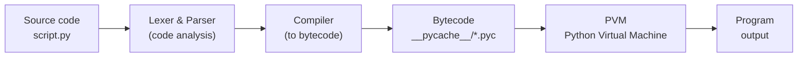

# Python introduction, Interpreter and Variables

## Introduction

Python is a high-level, general-purpose, interpreted programming language with a simple, readable syntax, dynamic typing, and automatic memory management. It is used in web development, data analysis, machine learning, automation, and scripting.

### A Brief History of Python

Python was created by Dutch programmer Guido van Rossum: he began work in late 1989, and the first public version (0.9.0) was released in 1991. The name is not derived from the snake, but from the British comedy show "Monty Python’s Flying Circus".

**Key milestones:**
- 1994 — Python 1.0.
- 2000 — Python 2.0: garbage collector, list comprehensions.
- 2008 — Python 3.0: a backwards-incompatible redesign of the language, particularly regarding string handling and Unicode.
- 2020 — Support for Python 2 officially ended.
- 2018 — Guido stepped down as "Benevolent Dictator For Life", and governance of the language transitioned to an elected Steering Council.

Today, the language evolves through PEP proposals under the auspices of the Python Software Foundation and ranks among the most popular languages in the world.

### Features

**Main features of Python:**
- **Simple and readable syntax** — blocks are defined by indentation, and the code resembles pseudocode.
- **Interpreted** — code is executed line by line without a separate compilation step (though it is compiled into bytecode under the hood).
- **Dynamic typing** — types are determined at runtime; optional type hints are supported.
- **Multi-paradigm** — supports object-oriented, procedural, and functional styles.
- **Automatic memory management** — uses reference counting and a garbage collector.
- **Rich standard library and ecosystem** — follows the "batteries included" philosophy with a vast number of packages available on PyPI.
- **Cross-platform** — runs on Windows, Linux, and macOS.
- **Everything is an object** — functions, classes, and modules are objects as well.
- **Built-in data structures** — lists, dictionaries, sets, and tuples.

**Disadvantages:** Lower execution speed compared to Java or C++, and the GIL (Global Interpreter Lock) restricts true multi-threading for CPU-bound tasks (though newer versions are actively working on a GIL-free mode).

### Application areas

**Key Application Areas of Python:**
- **Web Development** — backend development using Django, Flask, and FastAPI.
- **Data Analysis and Data Science** — pandas, NumPy, SciPy, Jupyter; data visualization via Matplotlib.
- **Machine Learning and AI** — PyTorch, TensorFlow, scikit-learn; virtually the industry standard in this field.
- **Automation and Scripting** — file processing, web scraping, system administration, and DevOps.
- **Testing** — pytest, Selenium, and QA automation.
- **Bots and Integrations** — Telegram bots and API integration.
- **Cybersecurity** — tools for penetration testing and analysis.
- **Education** — one of the most popular languages for introducing beginners to programming.
- **Scientific Computing and Engineering** — modeling, bioinformatics, and image processing.
- **Prototyping and Small Games** — Pygame and rapid MVP development.

---
## Interpreter of Python

### What is interpreter?

**An interpreter is a program that reads source code and executes it directly, without creating a separate executable file in advance.**

**How it works:**

- It takes the code (instruction by instruction or module as a whole), parses it, and executes it immediately.
- If there is an error in the code, it is detected at the moment that specific line is executed, rather than beforehand.

**Difference from a compiler:**

| **Feature**      | **Compiler**                                                                 | **Interpreter**                              |
| ---------------- | ---------------------------------------------------------------------------- | -------------------------------------------- |
| **What it does** | Translates the entire code into machine code (or bytecode) before execution. | Executes the code on the fly as it reads it. |
| **Result**       | A standalone executable file (`.exe`, `.class`, etc.).                       | No separate file, only the execution output. |
| **Errors**       | Detected before execution (compile-time).                                    | Detected during execution (runtime).         |
| **Examples**     | C, C++, Java (to bytecode).                                                  | Python, JavaScript, Ruby.                    |

The diagram shows how the CPython interpreter turns Python source code into the program's output.

**Steps:**

1. **Source code**
    
    The `script.py` file containing the code written by the programmer.
    
2. **Lexer & Parser**
    
    - **Lexer:** Breaks the text into tokens (words, numbers, operators, brackets).
        
    - **Parser:** Checks the syntax and builds an Abstract Syntax Tree (AST) from the tokens.
        
    - Syntax errors (`SyntaxError`) are detected here.
        
3. **Compiler**
    
    Converts the AST into bytecode—a set of low-level instructions for the virtual machine (not direct CPU machine code).
    
4. **Bytecode**
    
    The result of compilation. It is saved in the `__pycache__/` folder as `.pyc` files so that the next run can skip the parsing and compilation steps if the source code hasn't changed.
    
5. **PVM (Python Virtual Machine)**
    
    The virtual machine that executes bytecode instructions one by one. This is the step where the code actually runs, and runtime errors (`NameError`, `ZeroDivisionError`, etc.) occur here.
    
6. **Output**
    
    The program's result: text in the console, files, network responses, etc.