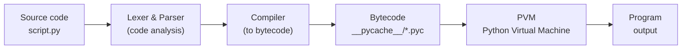
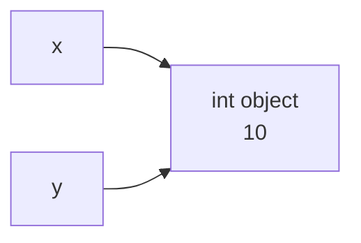

# Python introduction, Interpreter and Variables

## Introduction

Python is a high-level, general-purpose, interpreted programming language with a simple, readable syntax, dynamic typing, and automatic memory management. It is used in web development, data analysis, machine learning, automation, and scripting.

### A Brief History of Python

Python was created by Dutch programmer Guido van Rossum: he began work in late 1989, and the first public version (0.9.0) was released in 1991. The name is not derived from the snake, but from the British comedy show "Monty Python’s Flying Circus".

**Key milestones:**
- 1994 — Python 1.0.
- 2000 — Python 2.0: garbage collector, list comprehensions.
- 2008 — Python 3.0: a backwards-incompatible redesign of the language, particularly regarding string handling and Unicode.
- 2020 — Support for Python 2 officially ended.
- 2018 — Guido stepped down as "Benevolent Dictator For Life", and governance of the language transitioned to an elected Steering Council.

Today, the language evolves through PEP proposals under the auspices of the Python Software Foundation and ranks among the most popular languages in the world.

### Features

**Main features of Python:**
- **Simple and readable syntax** — blocks are defined by indentation, and the code resembles pseudocode.
- **Interpreted** — code is executed line by line without a separate compilation step (though it is compiled into bytecode under the hood).
- **Dynamic typing** — types are determined at runtime; optional type hints are supported.
- **Multi-paradigm** — supports object-oriented, procedural, and functional styles.
- **Automatic memory management** — uses reference counting and a garbage collector.
- **Rich standard library and ecosystem** — follows the "batteries included" philosophy with a vast number of packages available on PyPI.
- **Cross-platform** — runs on Windows, Linux, and macOS.
- **Everything is an object** — functions, classes, and modules are objects as well.
- **Built-in data structures** — lists, dictionaries, sets, and tuples.

**Disadvantages:** Lower execution speed compared to Java or C++, and the GIL (Global Interpreter Lock) restricts true multi-threading for CPU-bound tasks (though newer versions are actively working on a GIL-free mode).


### Application areas

**Key Application Areas of Python:**
- **Web Development** — backend development using Django, Flask, and FastAPI.
- **Data Analysis and Data Science** — pandas, NumPy, SciPy, Jupyter; data visualization via Matplotlib.
- **Machine Learning and AI** — PyTorch, TensorFlow, scikit-learn; virtually the industry standard in this field.
- **Automation and Scripting** — file processing, web scraping, system administration, and DevOps.
- **Testing** — pytest, Selenium, and QA automation.
- **Bots and Integrations** — Telegram bots and API integration.
- **Cybersecurity** — tools for penetration testing and analysis.
- **Education** — one of the most popular languages for introducing beginners to programming.
- **Scientific Computing and Engineering** — modeling, bioinformatics, and image processing.
- **Prototyping and Small Games** — Pygame and rapid MVP development.

---
## Interpreter of Python

### What is interpreter?

**An interpreter is a program that reads source code and executes it directly, without creating a separate executable file in advance.**

**How it works:**

- It takes the code (instruction by instruction or module as a whole), parses it, and executes it immediately.
- If there is an error in the code, it is detected at the moment that specific line is executed, rather than beforehand.

**Difference from a compiler:**

| **Feature**      | **Compiler**                                                                 | **Interpreter**                              |
| ---------------- | ---------------------------------------------------------------------------- | -------------------------------------------- |
| **What it does** | Translates the entire code into machine code (or bytecode) before execution. | Executes the code on the fly as it reads it. |
| **Result**       | A standalone executable file (`.exe`, `.class`, etc.).                       | No separate file, only the execution output. |
| **Errors**       | Detected before execution (compile-time).                                    | Detected during execution (runtime).         |
| **Examples**     | C, C++, Java (to bytecode).                                                  | Python, JavaScript, Ruby.                    |



The diagram shows how the CPython interpreter turns Python source code into the program's output.

**Steps:**

1. **Source code**
    
    The `script.py` file containing the code written by the programmer.
    
2. **Lexer & Parser**
    
    - **Lexer:** Breaks the text into tokens (words, numbers, operators, brackets).
        
    - **Parser:** Checks the syntax and builds an Abstract Syntax Tree (AST) from the tokens.
        
    - Syntax errors (`SyntaxError`) are detected here.
        
3. **Compiler**
    
    Converts the AST into bytecode—a set of low-level instructions for the virtual machine (not direct CPU machine code).
    
4. **Bytecode**
    
    The result of compilation. It is saved in the `__pycache__/` folder as `.pyc` files so that the next run can skip the parsing and compilation steps if the source code hasn't changed.
    
5. **PVM (Python Virtual Machine)**
    
    The virtual machine that executes bytecode instructions one by one. This is the step where the code actually runs, and runtime errors (`NameError`, `ZeroDivisionError`, etc.) occur here.
    
6. **Output**
    
    The program's result: text in the console, files, network responses, etc.

#### Viewing Bytecode via the `dis` Module

`dis` (disassembler) is a built-in module that shows the bytecode into which CPython has compiled your code. No installation is required.

```python
import dis

def add(a, b):
    return a + b

dis.dis(add)
```

Output (simplified, depends on Python version):
```
LOAD_FAST    a
LOAD_FAST    b
BINARY_OP    + 
RETURN_VALUE
```

**What the instructions mean:**

- `LOAD_FAST a` / `LOAD_FAST b` — push the values of variables onto the stack.
    
- `BINARY_OP +` — take the top two values from the stack, add them, and push the result back onto the stack.
    
- `RETURN_VALUE` — return the value from the top of the stack out of the function.

PVM (Python Virtual Machine) is a stack-based machine: instructions operate on a stack of values.

**Ways to invoke it:**

- `dis.dis(func)` — disassemble a function, class, or module.
    
- `dis.dis("x = 1 + 2")` — disassemble a string of code.
    
- `python -m dis script.py` — from the command line.


### Operating Modes

#### 1. Interactive Mode (REPL)

Read-Eval-Print Loop: the interpreter reads a command, executes it, prints the result, and waits for the next one.

Bash

```bash
$ python
>>> 2 + 3
5
>>> _ * 2
10
```

- `>>>` — input prompt.
    
- `_` — variable storing the result of the last expression.
    
- **Exit:** `exit()` or `Ctrl+D` (Windows: `Ctrl+Z`, then `Enter`).
    
- Convenient for quick experiments and code verification.

#### 2. Script Mode

Executing an entire file containing code at once.

Bash

```bash
python script.py
```

- The primary way to run programs.
    
- Arguments are available via `sys.argv`.

#### 3. One-Liner Mode

Executing code passed directly via the command line.

Bash

```bash
python -c "print(1)"
```

- Suitable for quick checks and use in shell scripts.

#### 4. Module Execution Mode

Running a module as a script by its name rather than by the file path.

Bash

```bash
python -m venv .venv
python -m http.server 8000
python -m pip install requests
```

- Python searches for the module in `sys.path`.
    
- Inside such a module, `__name__ == "__main__"`.
    
- Convenient for running standard tools (`venv`, `pip`, `http.server`) using the exact Python version you invoked.
    

#### Summary Table

|**Mode**|**Command**|**When to Use**|
|---|---|---|
|**REPL**|`python`|Experiments, testing ideas|
|**Script**|`python script.py`|Running programs|
|**One-Liner**|`python -c "..."`|Short commands|
|**Module**|`python -m module`|Standard tools, packages|

### Execution Features

#### 1. Line-by-Line Execution

Instructions are executed from top to bottom. Syntax errors are caught during compilation, while other errors are only caught when execution reaches the problematic line.

```python
print("Hello")
print(x)        # NameError
print("End")    # will not execute
```

#### 2. Dynamic Typing

The type is stored in the object, not in the variable; type checking occurs at runtime.

```python
x = 5        # int
x = "text"   # now str
5 + "a"      # TypeError at runtime
```

- Type annotations are not checked by the interpreter (use `mypy` for this).
    

#### 3. GIL (Global Interpreter Lock)

CPython's global lock: only one thread executes bytecode at a time.

- Protects internal structures (reference counters).
    
- Hinders the acceleration of CPU-bound tasks via `threading`.
    
- Does not interfere with I/O-bound tasks (the GIL is released while waiting).
    
- **Workarounds:** `multiprocessing`, `asyncio`, C extensions. An experimental no-GIL mode also exists.

#### 4. Entry Point

When run directly, `__name__ == "__main__"`; when imported, `__name__` equals the module name.

Python

```python
def main():
    print("Working")

if __name__ == "__main__":
    main()
```

#### 5. Shebang Line (Linux/macOS)

The first line telling the operating system which interpreter to use.

Python

```
#!/usr/bin/env python3
print("Hello")
```

Bash

```
chmod +x script.py
./script.py
```

- `env` searches for `python3` in the `PATH`, so it works correctly with virtual environments. It is ignored as a comment on Windows.

### In Brief

The Python interpreter parses the source code, compiles it into bytecode, and executes it using the PVM (Python Virtual Machine).

- **Startup modes:** REPL, script, `-c`, `-m`.
    
- **Key execution features:** runtime errors, dynamic typing, the GIL, the `__name__` entry point, and the shebang line.

---

## Variables in Python

### 1. Definition

A **variable** in Python is a name (a reference) bound to an object in memory. A variable does not store a value inside itself; it points to an object.

```python
x = 10
```

Here the name `x` is bound to an `int` object with the value `10`. The `=` operator is **assignment** (binding a name to an object), not copying a value into a memory cell.



After `y = x`, both names refer to the same object.


### 2. Declaration and Creation

- There is no separate declaration: a variable is created on its first assignment.
- No need to specify a type; it is determined by the object.
- Using a variable before assignment raises `NameError`.

```python
name = "Ali"     # str
age = 20         # int
price = 9.99     # float
is_ok = True     # bool
nothing = None   # NoneType
```

### 3. Dynamic Typing

The type belongs to the object, not to the name. The same name can be bound to objects of different types.

```python
x = 5
x = "text"    # no error, x now points to a str
```

Python is strongly typed: there is no implicit conversion between incompatible types.

```python
"5" + 5       # TypeError
"5" + str(5)  # "55"
```

Type checking: `type(x)`, `isinstance(x, int)`.

### 4. Naming Rules

- Consists of letters, digits, and `_`.
- Cannot start with a digit.
- Case-sensitive: `age` and `Age` are different names.
- Keywords cannot be used (`if`, `for`, `class`, `None`, `True`, etc.). List them with `import keyword; keyword.kwlist`.
- Spaces and special characters (`-`, `$`, `@`) are not allowed.

```python
user_name = "ok"
_count = 1
2name = 1      # SyntaxError
my-var = 1     # SyntaxError
class = 1      # SyntaxError
```

#### Conventions (PEP 8)

|What|Style|Example|
|---|---|---|
|Variables, functions|`snake_case`|`user_age`|
|Constants (by convention)|`UPPER_CASE`|`MAX_SIZE`|
|Classes|`PascalCase`|`UserAccount`|
|"Private" (by convention)|`_name`|`_cache`|
|Special (dunder)|`__name__`|`__init__`|

The language has no true constants: `MAX_SIZE = 100` can be reassigned; it is only a convention.

### 5. Ways of Assigning

```python
# Multiple assignment
a, b, c = 1, 2, 3

# One value to several names
x = y = z = 0

# Swapping values
a, b = b, a

# Unpacking
first, *rest = [1, 2, 3, 4]   # first=1, rest=[2, 3, 4]
x, y = (10, 20)

# Augmented assignment
n = 5
n += 2     # 7
n *= 3     # 21
```

Also: `-=`, `/=`, `//=`, `%=`, `**=`.

### 6. Object Identity

```python
a = [1, 2]
b = a
print(id(a) == id(b))   # True
print(a is b)           # True, the same object
print(a == [1, 2])      # True, equal values
```

- `id(x)` returns the object's identifier (in CPython, roughly its memory address).
- `is` compares identity, `==` compares values.
- Use `is` for `None`: `if x is None`.
- Avoid comparing numbers and strings with `is`: CPython caches small ints (roughly -5 to 256) and some strings, and this behavior is not guaranteed.

### 7. Deletion

```python
x = 10
del x
print(x)    # NameError
```

`del` removes the name, not the object. The object is freed by the garbage collector when no references to it remain.

### 8. Input and Output

```python
name = input("Name: ")     # always returns str
age = int(input("Age: "))
print(name, age)
print(f"{name} - {age}")   # f-string
```

### Summary

- A variable is a name bound to an object; the object holds the value.
- Created on first assignment; the type belongs to the object, not the name.
- Names follow the rules and PEP 8: `snake_case`, constants in `UPPER_CASE`.
- `is` compares identity, `==` compares values.
- `del` removes the name, not the object.


