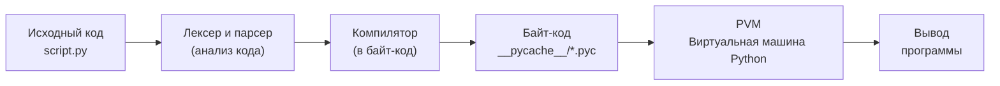
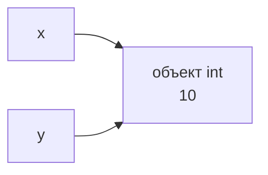

# Введение в Python, интерпретатор и переменные

## Введение

Python — это высокоуровневый интерпретируемый язык программирования общего назначения с простым и читаемым синтаксисом, динамической типизацией и автоматическим управлением памятью. Он используется в веб-разработке, анализе данных, машинном обучении, автоматизации и скриптинге.

### Краткая история Python

Python был создан голландским программистом Гвидо ван Россумом: он начал работу в конце 1989 года, а первая публичная версия (0.9.0) была выпущена в 1991 году. Название происходит не от змеи, а от британского комедийного шоу «Monty Python’s Flying Circus».

**Ключевые вехи:**

- 1994 — Python 1.0.
- 2000 — Python 2.0: сборщик мусора, списковые включения (list comprehensions).
- 2008 — Python 3.0: обратно несовместимая переработка языка, в частности в части работы со строками и Unicode.
- 2020 — Поддержка Python 2 официально прекращена.
- 2018 — Гвидо ушёл с поста «великодушного пожизненного диктатора» (Benevolent Dictator For Life), а управление языком перешло к избираемому Руководящему совету (Steering Council).

Сегодня язык развивается через PEP-предложения под эгидой Python Software Foundation и входит в число самых популярных языков в мире.

### Особенности

**Основные особенности Python:**

- **Простой и читаемый синтаксис** — блоки определяются отступами, а код напоминает псевдокод.
- **Интерпретируемый** — код выполняется построчно без отдельного этапа компиляции (хотя «под капотом» он компилируется в байт-код).
- **Динамическая типизация** — типы определяются во время выполнения; поддерживаются необязательные аннотации типов.
- **Мультипарадигменный** — поддерживает объектно-ориентированный, процедурный и функциональный стили.
- **Автоматическое управление памятью** — использует подсчёт ссылок и сборщик мусора.
- **Богатая стандартная библиотека и экосистема** — следует философии «батарейки в комплекте» (batteries included), множество пакетов доступно на PyPI.
- **Кроссплатформенный** — работает на Windows, Linux и macOS.
- **Всё является объектом** — функции, классы и модули — тоже объекты.
- **Встроенные структуры данных** — списки, словари, множества и кортежи.

**Недостатки:** Более низкая скорость выполнения по сравнению с Java или C++, а GIL (Global Interpreter Lock — глобальная блокировка интерпретатора) ограничивает настоящую многопоточность для CPU-bound задач (хотя в новых версиях активно ведётся работа над режимом без GIL).

### Области применения

**Ключевые области применения Python:**

- **Веб-разработка** — бэкенд-разработка с использованием Django, Flask и FastAPI.
- **Анализ данных и Data Science** — pandas, NumPy, SciPy, Jupyter; визуализация данных через Matplotlib.
- **Машинное обучение и ИИ** — PyTorch, TensorFlow, scikit-learn; фактически отраслевой стандарт в этой области.
- **Автоматизация и скриптинг** — обработка файлов, веб-скрейпинг, системное администрирование и DevOps.
- **Тестирование** — pytest, Selenium и автоматизация QA.
- **Боты и интеграции** — Telegram-боты и интеграция с API.
- **Кибербезопасность** — инструменты для тестирования на проникновение и анализа.
- **Образование** — один из самых популярных языков для знакомства новичков с программированием.
- **Научные вычисления и инженерия** — моделирование, биоинформатика и обработка изображений.
- **Прототипирование и небольшие игры** — Pygame и быстрая разработка MVP.

---

## Интерпретатор Python

### Что такое интерпретатор?

**Интерпретатор — это программа, которая читает исходный код и выполняет его напрямую, не создавая заранее отдельного исполняемого файла.**

**Как это работает:**

- Он берёт код (инструкцию за инструкцией или модуль целиком), разбирает его и сразу выполняет.
- Если в коде есть ошибка, она обнаруживается в момент выполнения именно этой строки, а не заранее.

**Отличие от компилятора:**

|**Признак**|**Компилятор**|**Интерпретатор**|
|---|---|---|
|**Что делает**|Переводит весь код в машинный код (или байт-код) до выполнения.|Выполняет код «на лету» по мере чтения.|
|**Результат**|Самостоятельный исполняемый файл (`.exe`, `.class` и т. д.).|Отдельного файла нет, только результат выполнения.|
|**Ошибки**|Обнаруживаются до выполнения (на этапе компиляции).|Обнаруживаются во время выполнения (в рантайме).|
|**Примеры**|C, C++, Java (в байт-код).|Python, JavaScript, Ruby.|



Диаграмма показывает, как интерпретатор CPython превращает исходный код Python в результат работы программы.

**Шаги:**

1. **Исходный код**
    
    Файл `script.py` с кодом, написанным программистом.
    
2. **Лексер и парсер**
    
    - **Лексер:** разбивает текст на токены (слова, числа, операторы, скобки).
        
    - **Парсер:** проверяет синтаксис и строит из токенов абстрактное синтаксическое дерево (AST).
        
    - Синтаксические ошибки (`SyntaxError`) обнаруживаются здесь.
        
3. **Компилятор**
    
    Преобразует AST в байт-код — набор низкоуровневых инструкций для виртуальной машины (не прямой машинный код процессора).
    
4. **Байт-код**
    
    Результат компиляции. Он сохраняется в папке `__pycache__/` в виде `.pyc`-файлов, чтобы при следующем запуске можно было пропустить этапы разбора и компиляции, если исходный код не изменился.
    
5. **PVM (виртуальная машина Python)**
    
    Виртуальная машина, которая выполняет инструкции байт-кода одну за другой. Именно на этом шаге код действительно запускается, и здесь возникают ошибки времени выполнения (`NameError`, `ZeroDivisionError` и т. д.).
    
6. **Вывод**
    
    Результат работы программы: текст в консоли, файлы, сетевые ответы и т. д.
    

#### Просмотр байт-кода через модуль `dis`

`dis` (дизассемблер) — встроенный модуль, показывающий байт-код, в который CPython скомпилировал ваш код. Установка не требуется.

```python
import dis

def add(a, b):
    return a + b

dis.dis(add)
```

Вывод (упрощённо, зависит от версии Python):

```
LOAD_FAST    a
LOAD_FAST    b
BINARY_OP    + 
RETURN_VALUE
```

**Что означают инструкции:**

- `LOAD_FAST a` / `LOAD_FAST b` — помещают значения переменных на стек.
    
- `BINARY_OP +` — берёт два верхних значения со стека, складывает их и помещает результат обратно на стек.
    
- `RETURN_VALUE` — возвращает значение с вершины стека из функции.
    

PVM (виртуальная машина Python) — это стековая машина: инструкции работают со стеком значений.

**Способы вызова:**

- `dis.dis(func)` — дизассемблировать функцию, класс или модуль.
    
- `dis.dis("x = 1 + 2")` — дизассемблировать строку с кодом.
    
- `python -m dis script.py` — из командной строки.
    

### Режимы работы

#### 1. Интерактивный режим (REPL)

Read-Eval-Print Loop (цикл «чтение — вычисление — вывод»): интерпретатор читает команду, выполняет её, выводит результат и ждёт следующую.

Bash

```bash
$ python
>>> 2 + 3
5
>>> _ * 2
10
```

- `>>>` — приглашение для ввода.
    
- `_` — переменная, хранящая результат последнего выражения.
    
- **Выход:** `exit()` или `Ctrl+D` (Windows: `Ctrl+Z`, затем `Enter`).
    
- Удобен для быстрых экспериментов и проверки кода.
    

#### 2. Режим скрипта

Выполнение сразу всего файла с кодом.

Bash

```bash
python script.py
```

- Основной способ запуска программ.
    
- Аргументы доступны через `sys.argv`.
    

#### 3. Режим однострочника

Выполнение кода, переданного прямо через командную строку.

Bash

```bash
python -c "print(1)"
```

- Подходит для быстрых проверок и использования в shell-скриптах.

#### 4. Режим запуска модуля

Запуск модуля как скрипта по его имени, а не по пути к файлу.

Bash

```bash
python -m venv .venv
python -m http.server 8000
python -m pip install requests
```

- Python ищет модуль в `sys.path`.
    
- Внутри такого модуля `__name__ == "__main__"`.
    
- Удобен для запуска стандартных инструментов (`venv`, `pip`, `http.server`) именно той версией Python, которую вы вызвали.
    

#### Сводная таблица

|**Режим**|**Команда**|**Когда использовать**|
|---|---|---|
|**REPL**|`python`|Эксперименты, проверка идей|
|**Скрипт**|`python script.py`|Запуск программ|
|**Однострочник**|`python -c "..."`|Короткие команды|
|**Модуль**|`python -m module`|Стандартные инструменты, пакеты|

### Особенности выполнения

#### 1. Построчное выполнение

Инструкции выполняются сверху вниз. Синтаксические ошибки отлавливаются во время компиляции, а остальные ошибки — только тогда, когда выполнение доходит до проблемной строки.

```python
print("Hello")
print(x)        # NameError
print("End")    # не выполнится
```

#### 2. Динамическая типизация

Тип хранится в объекте, а не в переменной; проверка типов происходит во время выполнения.

```python
x = 5        # int
x = "text"   # теперь str
5 + "a"      # TypeError во время выполнения
```

- Аннотации типов интерпретатором не проверяются (для этого используйте `mypy`).

#### 3. GIL (глобальная блокировка интерпретатора)

Глобальная блокировка CPython: в каждый момент времени только один поток выполняет байт-код.

- Защищает внутренние структуры (счётчики ссылок).
    
- Мешает ускорению CPU-bound задач через `threading`.
    
- Не мешает I/O-bound задачам (GIL освобождается во время ожидания).
    
- **Обходные пути:** `multiprocessing`, `asyncio`, C-расширения. Также существует экспериментальный режим без GIL.
    

#### 4. Точка входа

При прямом запуске `__name__ == "__main__"`; при импорте `__name__` равно имени модуля.

Python

```python
def main():
    print("Working")

if __name__ == "__main__":
    main()
```

#### 5. Строка shebang (Linux/macOS)

Первая строка, сообщающая операционной системе, какой интерпретатор использовать.

Python

```
#!/usr/bin/env python3
print("Hello")
```

Bash

```
chmod +x script.py
./script.py
```

- `env` ищет `python3` в `PATH`, поэтому корректно работает с виртуальными окружениями. В Windows игнорируется как комментарий.

### Вкратце

Интерпретатор Python разбирает исходный код, компилирует его в байт-код и выполняет с помощью PVM (виртуальной машины Python).

- **Режимы запуска:** REPL, скрипт, `-c`, `-m`.
    
- **Ключевые особенности выполнения:** ошибки времени выполнения, динамическая типизация, GIL, точка входа `__name__` и строка shebang.
    

---

## Переменные в Python

### 1. Определение

**Переменная** в Python — это имя (ссылка), связанное с объектом в памяти. Переменная не хранит значение внутри себя; она указывает на объект.

```python
x = 10
```

Здесь имя `x` связано с объектом типа `int` со значением `10`. Оператор `=` — это **присваивание** (привязка имени к объекту), а не копирование значения в ячейку памяти.



После `y = x` оба имени ссылаются на один и тот же объект.

### 2. Объявление и создание

- Отдельного объявления нет: переменная создаётся при первом присваивании.
- Указывать тип не нужно; он определяется объектом.
- Использование переменной до присваивания вызывает `NameError`.

```python
name = "Ali"     # str
age = 20         # int
price = 9.99     # float
is_ok = True     # bool
nothing = None   # NoneType
```

### 3. Динамическая типизация

Тип принадлежит объекту, а не имени. Одно и то же имя может быть связано с объектами разных типов.

```python
x = 5
x = "text"    # ошибки нет, x теперь указывает на str
```

Python — язык со строгой типизацией: неявного преобразования между несовместимыми типами нет.

```python
"5" + 5       # TypeError
"5" + str(5)  # "55"
```

Проверка типа: `type(x)`, `isinstance(x, int)`.

### 4. Правила именования

- Состоит из букв, цифр и `_`.
- Не может начинаться с цифры.
- Чувствительно к регистру: `age` и `Age` — разные имена.
- Нельзя использовать ключевые слова (`if`, `for`, `class`, `None`, `True` и т. д.). Вывести их список: `import keyword; keyword.kwlist`.
- Пробелы и специальные символы (`-`, `$`, `@`) не допускаются.

```python
user_name = "ok"
_count = 1
2name = 1      # SyntaxError
my-var = 1     # SyntaxError
class = 1      # SyntaxError
```

#### Соглашения (PEP 8)

|Что|Стиль|Пример|
|---|---|---|
|Переменные, функции|`snake_case`|`user_age`|
|Константы (по соглашению)|`UPPER_CASE`|`MAX_SIZE`|
|Классы|`PascalCase`|`UserAccount`|
|«Приватные» (по соглашению)|`_name`|`_cache`|
|Специальные (dunder)|`__name__`|`__init__`|

В языке нет настоящих констант: `MAX_SIZE = 100` можно переприсвоить; это лишь соглашение.

### 5. Способы присваивания

```python
# Множественное присваивание
a, b, c = 1, 2, 3

# Одно значение нескольким именам
x = y = z = 0

# Обмен значений
a, b = b, a

# Распаковка
first, *rest = [1, 2, 3, 4]   # first=1, rest=[2, 3, 4]
x, y = (10, 20)

# Составное присваивание
n = 5
n += 2     # 7
n *= 3     # 21
```

Также: `-=`, `/=`, `//=`, `%=`, `**=`.

### 6. Идентичность объектов

```python
a = [1, 2]
b = a
print(id(a) == id(b))   # True
print(a is b)           # True, тот же объект
print(a == [1, 2])      # True, значения равны
```

- `id(x)` возвращает идентификатор объекта (в CPython — примерно его адрес в памяти).
- `is` сравнивает идентичность, `==` сравнивает значения.
- Для `None` используйте `is`: `if x is None`.
- Избегайте сравнения чисел и строк через `is`: CPython кэширует малые целые числа (примерно от -5 до 256) и некоторые строки, и такое поведение не гарантируется.

### 7. Удаление

```python
x = 10
del x
print(x)    # NameError
```

`del` удаляет имя, а не объект. Объект освобождается сборщиком мусора, когда на него не остаётся ссылок.

### 8. Ввод и вывод

```python
name = input("Name: ")     # всегда возвращает str
age = int(input("Age: "))
print(name, age)
print(f"{name} - {age}")   # f-строка
```

### Итоги

- Переменная — это имя, связанное с объектом; значение хранит объект.
- Создаётся при первом присваивании; тип принадлежит объекту, а не имени.
- Имена подчиняются правилам и PEP 8: `snake_case`, константы — `UPPER_CASE`.
- `is` сравнивает идентичность, `==` сравнивает значения.
- `del` удаляет имя, а не объект.