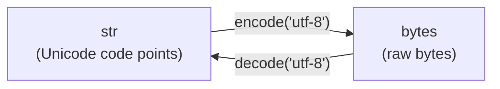

# Strings and String Methods in Python

## Introduction

A **string** (`str`) is an **immutable sequence of Unicode characters** (code points). Strings are used for text of any kind: names, messages, file paths, JSON, HTML, and so on.

```python
s = "Hello, Python"
type(s)      # <class 'str'>
len(s)       # 13
```

**Key properties:**

- **Immutable** — a string cannot be changed after creation; every "modification" creates a new string.
- **Sequence** — supports indexing, slicing, iteration, `len()`, `in`.
- **Unicode** — Python 3 strings store Unicode code points; there is no separate "character" type (a character is a string of length 1).
- **Hashable** — can be used as a `dict` key or a `set` element.
- **Methods return new strings** — `s.upper()` does not change `s`.

```python
s = "abc"
s[0] = "X"       # TypeError: 'str' object does not support item assignment
s = "X" + s[1:]  # correct: build a new string
```

---

## Creating Strings

### Quotes

```python
a = 'single quotes'
b = "double quotes"
c = "It's easy"            # a quote of the other type inside, no escaping needed
d = 'He said "hi"'
```

Single and double quotes are **equivalent**; choose one style and stay consistent (PEP 8 does not prefer either).

### Triple-Quoted Strings

Span several lines and keep line breaks. Often used for docstrings.

```python
text = """Line 1
Line 2
Line 3"""

def f():
    """Docstring of the function."""
```

### Implicit Concatenation

Adjacent string literals are joined at compile time.

```python
query = (
    "SELECT * "
    "FROM users "
    "WHERE age > 18"
)
```

### Conversion to String

```python
str(123)         # "123"
str(3.14)        # "3.14"
str(True)        # "True"
str([1, 2])      # "[1, 2]"
str(None)        # "None"
list("abc")      # ['a', 'b', 'c']
```

### `str()` vs `repr()` vs `ascii()`

|**Function**|**Purpose**|**Example for `"hi\n"`**|
|---|---|---|
|`str(x)`|Readable form for users|`hi` + newline|
|`repr(x)`|Unambiguous form for developers|`'hi\n'`|
|`ascii(x)`|Like `repr`, but non-ASCII escaped|`'hi\n'`|

---

## Escape Sequences

A backslash `\` starts a special character.

|**Sequence**|**Meaning**|
|---|---|
|`\n`|Newline|
|`\t`|Tab|
|`\r`|Carriage return|
|`\\`|Backslash|
|`\'`|Single quote|
|`\"`|Double quote|
|`\0`|Null character|
|`\xhh`|Character with hex code `hh`|
|`\uXXXX`|Unicode character (16-bit)|
|`\UXXXXXXXX`|Unicode character (32-bit)|
|`\N{name}`|Unicode character by name|

```python
print("Line1\nLine2")       # two lines
print("Col1\tCol2")         # tab
print("C:\\Users")          # C:\Users
print("\u00e9")             # é
print("\N{GREEK SMALL LETTER ALPHA}")   # α
```

### Raw Strings (`r"..."`)

Backslashes are **not** treated as escapes. Useful for regular expressions and Windows paths.

```python
path = r"C:\new\table"      # backslashes preserved
pattern = r"\d+\.\d+"       # regex
```

- A raw string cannot end with an **odd** number of backslashes: `r"abc\"` is a `SyntaxError`.

---

## Indexing and Slicing

### Indexing

Indexes start at `0`; negative indexes count from the end.

```
 P   y   t   h   o   n
 0   1   2   3   4   5     <- positive indexes
-6  -5  -4  -3  -2  -1     <- negative indexes
```

```python
s = "Python"
s[0]       # 'P'
s[3]       # 'h'
s[-1]      # 'n'
s[-2]      # 'o'
s[10]      # IndexError: string index out of range
```

### Slicing `s[start:stop:step]`

- `start` — inclusive, default `0`.
- `stop` — **exclusive**, default `len(s)`.
- `step` — default `1`; negative reverses direction.

```python
s = "Python"
s[0:2]       # 'Py'
s[2:]        # 'thon'
s[:3]        # 'Pyt'
s[-3:]       # 'hon'
s[::2]       # 'Pto'
s[::-1]      # 'nohtyP'  (reversed)
s[1:-1]      # 'ytho'
s[2:100]     # 'thon'    (slicing never raises IndexError)
s[:]         # copy of the whole string
```

---

## Basic Operations

|**Operation**|**Example**|**Result**|
|---|---|---|
|Concatenation|`"ab" + "cd"`|`'abcd'`|
|Repetition|`"ab" * 3`|`'ababab'`|
|Length|`len("hello")`|`5`|
|Membership|`"ell" in "hello"`|`True`|
|Non-membership|`"x" not in "hello"`|`True`|
|Comparison|`"apple" < "banana"`|`True`|
|Iteration|`for ch in "abc": ...`|`'a'`, `'b'`, `'c'`|

```python
"5" + 5          # TypeError — only str + str is allowed
"5" + str(5)     # '55'
```

### Comparison

Strings are compared **lexicographically by Unicode code point**.

```python
"a" < "b"        # True
"Z" < "a"        # True  (ord("Z") = 90, ord("a") = 97)
"apple" < "apple pie"   # True (prefix is smaller)
"abc" == "abc"   # True
```

- Comparison is **case-sensitive**.
- For case-insensitive comparison use `casefold()`: `a.casefold() == b.casefold()`.
- Sorting ignoring case: `sorted(words, key=str.casefold)`.

### Characters and Code Points

```python
ord("A")       # 65
ord("я")       # 1103
chr(97)        # 'a'
chr(8364)      # '€'
```

---

## String Formatting

### 1. f-strings (Python 3.6+) — recommended

Expressions inside `{}` are evaluated at runtime.

```python
name = "Ali"
age = 20
f"{name} is {age} years old"        # 'Ali is 20 years old'
f"{age + 1}"                        # '21'
f"{name.upper()}"                   # 'ALI'
f"{name!r}"                         # "'Ali'"  (repr)
f"{age=}"                           # 'age=20'  (3.8+, great for debugging)
```

### 2. `str.format()`

```python
"{} is {}".format("Ali", 20)             # positional
"{0} {1} {0}".format("a", "b")           # 'a b a'
"{name} is {age}".format(name="Ali", age=20)
```

### 3. `%` formatting (old style)

```python
"%s is %d years old" % ("Ali", 20)
"%.2f" % 3.14159                          # '3.14'
```

Mostly found in legacy code; prefer f-strings.

### Format Specification Mini-Language

Syntax: `{value:[[fill]align][sign][0][width][,][.precision][type]}`

|**Spec**|**Meaning**|**Example**|**Result**|
|---|---|---|---|
|`.2f`|2 decimal places|`f"{3.14159:.2f}"`|`'3.14'`|
|`10`|Minimum width 10|`f"{'ab':10}"`|`'ab '`|
|`>10`|Right-align|`f"{'ab':>10}"`|`' ab'`|
|`<10`|Left-align|`f"{'ab':<10}"`|`'ab '`|
|`^10`|Center|`f"{'ab':^10}"`|`' ab '`|
|`*^10`|Center with fill `*`|`f"{'ab':*^10}"`|`'****ab****'`|
|`05d`|Zero-pad to width 5|`f"{42:05d}"`|`'00042'`|
|`,`|Thousands separator|`f"{1234567:,}"`|`'1,234,567'`|
|`+`|Always show sign|`f"{5:+d}"`|`'+5'`|
|`%`|Percentage|`f"{0.256:.1%}"`|`'25.6%'`|
|`e`|Scientific notation|`f"{12345.678:.2e}"`|`'1.23e+04'`|
|`b` / `o`|Binary / octal|`f"{10:b}"`|`'1010'`|
|`x` / `X`|Hexadecimal|`f"{255:x}"`|`'ff'`|

```python
price = 1234.5
f"Total: {price:>12,.2f}"       # 'Total:     1,234.50'
```

---

## String Methods

> All methods return a **new** string (or another value) and leave the original unchanged.

### 1. Case Conversion

|**Method**|**Description**|**Example**|
|---|---|---|
|`upper()`|All uppercase|`"abc".upper()` -> `'ABC'`|
|`lower()`|All lowercase|`"ABC".lower()` -> `'abc'`|
|`capitalize()`|First char upper, rest lower|`"hELLO".capitalize()` -> `'Hello'`|
|`title()`|Each word starts with uppercase|`"hello world".title()` -> `'Hello World'`|
|`swapcase()`|Swap case of every letter|`"aBc".swapcase()` -> `'AbC'`|
|`casefold()`|Aggressive lowercase for comparisons|`"Straße".casefold()` -> `'strasse'`|

```python
"they're".title()     # "They'Re"  (title() has apostrophe pitfalls)
"ß".upper()           # 'SS'  (length can change!)
```

### 2. Searching

|**Method**|**Description**|**If not found**|
|---|---|---|
|`find(sub[, start, end])`|Index of first occurrence|returns `-1`|
|`rfind(sub)`|Index of last occurrence|returns `-1`|
|`index(sub)`|Like `find`|raises `ValueError`|
|`rindex(sub)`|Like `rfind`|raises `ValueError`|
|`count(sub[, start, end])`|Number of **non-overlapping** occurrences|returns `0`|
|`startswith(prefix)`|Starts with prefix (str or **tuple** of prefixes)|`False`|
|`endswith(suffix)`|Ends with suffix (str or **tuple** of suffixes)|`False`|

```python
s = "hello world"
s.find("o")            # 4
s.rfind("o")           # 7
s.find("z")            # -1
s.index("z")           # ValueError
s.count("l")           # 3
"aaaa".count("aa")     # 2  (non-overlapping)
s.startswith("hell")   # True
"photo.png".endswith((".png", ".jpg"))   # True
```

- To simply check presence, use `in`: `if "x" in s`. Do not use `find(...) != -1`.
- Remember: `find` can return `0`, which is falsy; `if s.find("h"):` is a bug.

### 3. Checking Content (`is...` methods)

All return `bool`. For an **empty string** they return `False` (except `isascii`, `isprintable`).

|**Method**|**True if...**|
|---|---|
|`isalpha()`|All characters are letters|
|`isdigit()`|All characters are digits (includes `²`, `³`)|
|`isdecimal()`|All characters are decimal digits (`0-9` and similar)|
|`isnumeric()`|All characters are numeric (includes `½`, `²`, Chinese numerals)|
|`isalnum()`|All characters are letters or digits|
|`isspace()`|All characters are whitespace|
|`isupper()`|Has cased letters and all of them are uppercase|
|`islower()`|Has cased letters and all of them are lowercase|
|`istitle()`|Title-cased string|
|`isidentifier()`|Valid Python identifier|
|`isascii()`|All characters are ASCII (empty string -> `True`)|
|`isprintable()`|All characters are printable|

```python
"abc".isalpha()      # True
"abc1".isalpha()     # False
"123".isdigit()      # True
"²".isdigit()        # True
"²".isdecimal()      # False
"½".isnumeric()      # True
"".isalpha()         # False
"-5".isdigit()       # False  (minus and dot are not digits)
"3.14".isdigit()     # False
```

- To validate a number, use `try: int(s)` / `float(s)` rather than `isdigit()`.

### 4. Removing Whitespace and Affixes

|**Method**|**Description**|
|---|---|
|`strip([chars])`|Remove from both ends|
|`lstrip([chars])`|Remove from the left|
|`rstrip([chars])`|Remove from the right|
|`removeprefix(prefix)`|Remove exact prefix (3.9+)|
|`removesuffix(suffix)`|Remove exact suffix (3.9+)|

```python
"  hi  ".strip()          # 'hi'
"  hi  ".lstrip()         # 'hi  '
"  hi  ".rstrip()         # '  hi'
"\n text\t".strip()       # 'text'
"xxhixx".strip("x")       # 'hi'
```

**Pitfall:** the argument of `strip` is a **set of characters**, not a substring.

```python
"text.txt".rstrip(".txt")         # 'te'  (removes any of '.', 't', 'x')
"text.txt".removesuffix(".txt")   # 'text'  (correct)
```

### 5. Splitting and Joining

|**Method**|**Description**|
|---|---|
|`split(sep=None, maxsplit=-1)`|Split into a list|
|`rsplit(sep, maxsplit)`|Split from the right|
|`splitlines(keepends=False)`|Split on line boundaries|
|`partition(sep)`|Split into 3 parts: before, separator, after (first sep)|
|`rpartition(sep)`|Same, using the last separator|
|`sep.join(iterable)`|Join strings with separator|

```python
"a,b,c".split(",")            # ['a', 'b', 'c']
"a,b,c".split(",", 1)         # ['a', 'b,c']
"a,b,c".rsplit(",", 1)        # ['a,b', 'c']
"a  b   c".split()            # ['a', 'b', 'c']   (any whitespace, no empties)
"a  b".split(" ")             # ['a', '', 'b']    (explicit sep keeps empties)
"".split(",")                 # ['']
"".split()                    # []
"l1\nl2\r\nl3".splitlines()   # ['l1', 'l2', 'l3']

"key=value=x".partition("=")  # ('key', '=', 'value=x')
"no-sep".partition("=")       # ('no-sep', '', '')

", ".join(["a", "b", "c"])    # 'a, b, c'
"".join(["a", "b", "c"])      # 'abc'
"-".join("abc")               # 'a-b-c'
", ".join([1, 2])             # TypeError — items must be str
", ".join(map(str, [1, 2]))   # '1, 2'
```

### 6. Replacing and Translating

|**Method**|**Description**|
|---|---|
|`replace(old, new[, count])`|Replace all (or first `count`) occurrences|
|`translate(table)`|Map characters using a translation table|
|`str.maketrans(...)`|Build a translation table|
|`expandtabs(tabsize=8)`|Replace tabs with spaces|

```python
"hello".replace("l", "L")        # 'heLLo'
"hello".replace("l", "L", 1)     # 'heLlo'
"a.b.c".replace(".", "")         # 'abc'

table = str.maketrans("abc", "xyz")
"aabbcc".translate(table)        # 'xxyyzz'

table = str.maketrans("", "", "aeiou")     # third arg = characters to delete
"education".translate(table)     # 'dctn'
```

- `replace` is **case-sensitive** and does not support patterns; for patterns use the `re` module.

### 7. Alignment and Padding

|**Method**|**Description**|**Example**|
|---|---|---|
|`center(width[, fill])`|Center in a field of given width|`"ab".center(6, "*")` -> `'**ab**'`|
|`ljust(width[, fill])`|Left-align|`"ab".ljust(5, ".")` -> `'ab...'`|
|`rjust(width[, fill])`|Right-align|`"ab".rjust(5, ".")` -> `'...ab'`|
|`zfill(width)`|Pad with zeros on the left (keeps sign)|`"42".zfill(5)` -> `'00042'`|

```python
"-42".zfill(6)        # '-00042'
```

### 8. Encoding and Decoding

```python
s = "Привет"
b = s.encode("utf-8")       # b'\xd0\x9f\xd1\x80...'
b.decode("utf-8")           # 'Привет'
```



- `str` = text; `bytes` = binary data. They are **different types**: `"a" + b"a"` raises `TypeError`.
- Default encoding for `encode()` / `decode()` is **UTF-8**.
- Always specify encoding when working with files: `open("f.txt", encoding="utf-8")`.
- Errors: `UnicodeEncodeError`, `UnicodeDecodeError`; the `errors` argument (`"ignore"`, `"replace"`) can suppress them (at the cost of data loss).

### 9. Other Useful Methods and Functions

```python
"{} {}".format("a", "b")          # format
"Hello {name}".format_map({"name": "Ali"})   # format from a mapping
len("hello")                      # 5
min("hello"), max("hello")        # ('e', 'o')
sorted("hello")                   # ['e', 'h', 'l', 'l', 'o']
"".join(sorted("hello"))          # 'ehllo'
reversed("abc")                   # iterator; use "".join(reversed("abc"))
list(enumerate("ab"))             # [(0, 'a'), (1, 'b')]
```

### Quick Reference by Task

|**Task**|**Use**|
|---|---|
|Change case|`upper()`, `lower()`, `casefold()`|
|Check presence|`in`, `startswith()`, `endswith()`|
|Find position|`find()`, `index()`|
|Trim whitespace|`strip()`, `lstrip()`, `rstrip()`|
|Remove exact prefix/suffix|`removeprefix()`, `removesuffix()`|
|String -> list|`split()`, `splitlines()`, `partition()`|
|List -> string|`sep.join(list)`|
|Replace text|`replace()`, `translate()`|
|Pad / align|`ljust()`, `rjust()`, `center()`, `zfill()`|
|Validate content|`isdigit()`, `isalpha()`, `isalnum()`|
|Insert values|f-strings, `format()`|
|Convert str <-> bytes|`encode()`, `decode()`|

---

## Immutability and Performance

Because strings are immutable, each concatenation creates a **new object**.

```python
# Slow: creates many intermediate strings
result = ""
for word in words:
    result += word + " "

# Fast: one pass
result = " ".join(words)
```

**Rules of thumb:**

- Build large strings with `"".join(list_of_parts)`.
- For heavy incremental building use `io.StringIO`.
- To "modify" characters, convert to a list, change it, and join back.

```python
chars = list("hello")
chars[0] = "J"
"".join(chars)       # 'Jello'
```

### Identity and Interning

```python
a = "hello"
b = "hello"
a is b       # often True (interning), but NOT guaranteed
a == b       # True — always compare strings with ==
```

- CPython may reuse (intern) identical short strings; this is an implementation detail.
- Never rely on `is` for strings.

---

## Unicode Notes

- `len(s)` counts **code points**, not bytes and not always visible symbols.
- The same visible character can have different representations.

```python
a = "é"             # one code point (U+00E9)
b = "e\u0301"       # 'e' + combining accent (two code points)
a == b              # False
len(a), len(b)      # (1, 2)

import unicodedata
unicodedata.normalize("NFC", b) == a    # True
```

- Normalize text (`NFC` / `NFKC`) before comparing user input.
- Byte length depends on encoding: `len("é".encode("utf-8"))` is `2`.
- Some operations change length: `"ß".upper()` -> `'SS'`.

### The `string` Module

```python
import string
string.ascii_lowercase   # 'abcdefghijklmnopqrstuvwxyz'
string.ascii_uppercase   # 'ABCDEFGHIJKLMNOPQRSTUVWXYZ'
string.ascii_letters
string.digits            # '0123456789'
string.punctuation       # '!"#$%&...'
string.whitespace
```

---

## Common Pitfalls

|**Mistake**|**Problem / Fix**|
|---|---|
|`s[0] = "X"`|`TypeError`; strings are immutable, build a new one|
|`"age: " + 20`|`TypeError`; use `str(20)` or an f-string|
|`s.upper()` without assignment|Result is lost; write `s = s.upper()`|
|`if s.find("a"):`|`find` may return `0` (falsy) or `-1` (truthy); use `in`|
|`"text.txt".rstrip(".txt")`|`strip` takes a set of chars; use `removesuffix()`|
|`", ".join([1, 2])`|`TypeError`; convert items with `map(str, ...)`|
|`s += x` in a big loop|Slow; collect parts in a list and `join`|
|`a is b` for strings|Unreliable; use `==`|
|`"a" < "B"` expecting alphabetical|Compares code points; use `casefold()` for case-insensitive|
|`"a b".split(" ")` with many spaces|Produces empty strings; use `split()` without arguments|
|`r"C:\dir\"`|`SyntaxError`; raw string cannot end with a single backslash|
|Opening files without `encoding`|Platform-dependent; always pass `encoding="utf-8"`|
|`"".isalpha()` expected `True`|Empty string gives `False` for most `is...` methods|

---

## Summary

- A `str` is an **immutable sequence of Unicode code points**; all "changes" create new strings.
- Create with `'...'`, `"..."`, `"""..."""`; use **raw strings** (`r"..."`) for regex and paths; escape sequences start with `\`.
- **Indexing** `s[i]` (negative from the end) and **slicing** `s[start:stop:step]`; `s[::-1]` reverses; slicing never raises `IndexError`.
- Operators: `+`, `*`, `in`, `len()`, comparison by **code point**; no implicit conversion between `str` and numbers.
- **Formatting:** prefer **f-strings** with the format mini-language (`:.2f`, `:>10`, `:,`, `:05d`).
- **Methods:** case (`upper`, `lower`, `casefold`), search (`find`, `index`, `count`, `startswith`), checks (`isdigit`, `isalpha`, ...), trimming (`strip`, `removeprefix`), split/join (`split`, `partition`, `join`), replace (`replace`, `translate`), padding (`ljust`, `center`, `zfill`).
- `strip()` works with a **set of characters**; `split()` without arguments handles any whitespace; `join()` requires all items to be `str`.
- **str <-> bytes** via `encode()` / `decode()`; default and recommended encoding is **UTF-8**.
- Build large strings with `"".join(...)`; compare with `==`, never `is`; normalize Unicode before comparing user input.