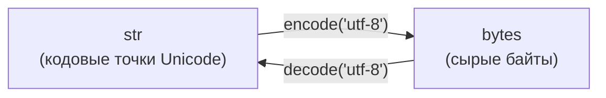

# Строки и методы строк в Python

## Введение

**Строка** (`str`) — это **неизменяемая последовательность символов Unicode** (кодовых точек). Строки используются для любого текста: имена, сообщения, пути к файлам, JSON, HTML и т.д.

```python
s = "Hello, Python"
type(s)      # <class 'str'>
len(s)       # 13
```

**Ключевые свойства:**

- **Неизменяемость (immutable)** — строку нельзя изменить после создания; любое «изменение» создаёт новую строку.
- **Последовательность** — поддерживает индексацию, срезы, итерацию, `len()`, `in`.
- **Unicode** — строки Python 3 хранят кодовые точки Unicode; отдельного типа «символ» нет (символ — это строка длиной 1).
- **Хешируемость** — строку можно использовать как ключ `dict` или элемент `set`.
- **Методы возвращают новые строки** — `s.upper()` не изменяет `s`.

```python
s = "abc"
s[0] = "X"       # TypeError: 'str' object does not support item assignment
s = "X" + s[1:]  # правильно: создаём новую строку
```

---

## Создание строк

### Кавычки

```python
a = 'single quotes'
b = "double quotes"
c = "It's easy"            # кавычка другого типа внутри, экранирование не нужно
d = 'He said "hi"'
```

Одинарные и двойные кавычки **равнозначны**; выберите один стиль и придерживайтесь его (PEP 8 не отдаёт предпочтения ни одному).

### Строки в тройных кавычках

Занимают несколько строк и сохраняют переносы. Часто используются для docstring.

```python
text = """Line 1
Line 2
Line 3"""

def f():
    """Docstring of the function."""
```

### Неявная конкатенация

Соседние строковые литералы склеиваются во время компиляции.

```python
query = (
    "SELECT * "
    "FROM users "
    "WHERE age > 18"
)
```

### Преобразование в строку

```python
str(123)         # "123"
str(3.14)        # "3.14"
str(True)        # "True"
str([1, 2])      # "[1, 2]"
str(None)        # "None"
list("abc")      # ['a', 'b', 'c']
```

### `str()`, `repr()` и `ascii()`

|**Функция**|**Назначение**|**Пример для `"hi\n"`**|
|---|---|---|
|`str(x)`|Читаемый вид для пользователей|`hi` + перевод строки|
|`repr(x)`|Однозначный вид для разработчиков|`'hi\n'`|
|`ascii(x)`|Как `repr`, но не-ASCII экранируется|`'hi\n'`|

---

## Escape-последовательности

Обратный слеш `\` начинает специальный символ.

|**Последовательность**|**Значение**|
|---|---|
|`\n`|Перевод строки|
|`\t`|Табуляция|
|`\r`|Возврат каретки|
|`\\`|Обратный слеш|
|`\'`|Одинарная кавычка|
|`\"`|Двойная кавычка|
|`\0`|Нулевой символ|
|`\xhh`|Символ с шестнадцатеричным кодом `hh`|
|`\uXXXX`|Символ Unicode (16 бит)|
|`\UXXXXXXXX`|Символ Unicode (32 бита)|
|`\N{name}`|Символ Unicode по имени|

```python
print("Line1\nLine2")       # две строки
print("Col1\tCol2")         # табуляция
print("C:\\Users")          # C:\Users
print("\u00e9")             # é
print("\N{GREEK SMALL LETTER ALPHA}")   # α
```

### Сырые строки (`r"..."`)

Обратные слеши **не** считаются escape-символами. Удобно для регулярных выражений и путей Windows.

```python
path = r"C:\new\table"      # слеши сохраняются
pattern = r"\d+\.\d+"       # regex
```

- Сырая строка не может заканчиваться **нечётным** числом обратных слешей: `r"abc\"` — это `SyntaxError`.

---

## Индексация и срезы

### Индексация

Индексы начинаются с `0`; отрицательные индексы считаются с конца.

```
 P   y   t   h   o   n
 0   1   2   3   4   5     <- положительные индексы
-6  -5  -4  -3  -2  -1     <- отрицательные индексы
```

```python
s = "Python"
s[0]       # 'P'
s[3]       # 'h'
s[-1]      # 'n'
s[-2]      # 'o'
s[10]      # IndexError: string index out of range
```

### Срезы `s[start:stop:step]`

- `start` — включительно, по умолчанию `0`.
- `stop` — **не включается**, по умолчанию `len(s)`.
- `step` — по умолчанию `1`; отрицательный меняет направление.

```python
s = "Python"
s[0:2]       # 'Py'
s[2:]        # 'thon'
s[:3]        # 'Pyt'
s[-3:]       # 'hon'
s[::2]       # 'Pto'
s[::-1]      # 'nohtyP'  (в обратном порядке)
s[1:-1]      # 'ytho'
s[2:100]     # 'thon'    (срез никогда не вызывает IndexError)
s[:]         # копия всей строки
```

---

## Базовые операции

|**Операция**|**Пример**|**Результат**|
|---|---|---|
|Конкатенация|`"ab" + "cd"`|`'abcd'`|
|Повторение|`"ab" * 3`|`'ababab'`|
|Длина|`len("hello")`|`5`|
|Принадлежность|`"ell" in "hello"`|`True`|
|Отсутствие|`"x" not in "hello"`|`True`|
|Сравнение|`"apple" < "banana"`|`True`|
|Итерация|`for ch in "abc": ...`|`'a'`, `'b'`, `'c'`|

```python
"5" + 5          # TypeError — допустимо только str + str
"5" + str(5)     # '55'
```

### Сравнение

Строки сравниваются **лексикографически по кодовым точкам Unicode**.

```python
"a" < "b"        # True
"Z" < "a"        # True  (ord("Z") = 90, ord("a") = 97)
"apple" < "apple pie"   # True (префикс меньше)
"abc" == "abc"   # True
```

- Сравнение **чувствительно к регистру**.
- Для сравнения без учёта регистра используйте `casefold()`: `a.casefold() == b.casefold()`.
- Сортировка без учёта регистра: `sorted(words, key=str.casefold)`.

### Символы и кодовые точки

```python
ord("A")       # 65
ord("я")       # 1103
chr(97)        # 'a'
chr(8364)      # '€'
```

---

## Форматирование строк

### 1. f-строки (Python 3.6+) — рекомендуется

Выражения внутри `{}` вычисляются во время выполнения.

```python
name = "Ali"
age = 20
f"{name} is {age} years old"        # 'Ali is 20 years old'
f"{age + 1}"                        # '21'
f"{name.upper()}"                   # 'ALI'
f"{name!r}"                         # "'Ali'"  (repr)
f"{age=}"                           # 'age=20'  (3.8+, удобно для отладки)
```

### 2. `str.format()`

```python
"{} is {}".format("Ali", 20)             # позиционные аргументы
"{0} {1} {0}".format("a", "b")           # 'a b a'
"{name} is {age}".format(name="Ali", age=20)
```

### 3. Форматирование через `%` (старый стиль)

```python
"%s is %d years old" % ("Ali", 20)
"%.2f" % 3.14159                          # '3.14'
```

Встречается в основном в устаревшем коде; предпочитайте f-строки.

### Мини-язык спецификаций формата

Синтаксис: `{value:[[fill]align][sign][0][width][,][.precision][type]}`

|**Спецификация**|**Значение**|**Пример**|**Результат**|
|---|---|---|---|
|`.2f`|2 знака после запятой|`f"{3.14159:.2f}"`|`'3.14'`|
|`10`|Минимальная ширина 10|`f"{'ab':10}"`|`'ab '`|
|`>10`|Выравнивание вправо|`f"{'ab':>10}"`|`' ab'`|
|`<10`|Выравнивание влево|`f"{'ab':<10}"`|`'ab '`|
|`^10`|По центру|`f"{'ab':^10}"`|`' ab '`|
|`*^10`|По центру с заполнителем `*`|`f"{'ab':*^10}"`|`'****ab****'`|
|`05d`|Дополнение нулями до ширины 5|`f"{42:05d}"`|`'00042'`|
|`,`|Разделитель тысяч|`f"{1234567:,}"`|`'1,234,567'`|
|`+`|Всегда показывать знак|`f"{5:+d}"`|`'+5'`|
|`%`|Проценты|`f"{0.256:.1%}"`|`'25.6%'`|
|`e`|Научная запись|`f"{12345.678:.2e}"`|`'1.23e+04'`|
|`b` / `o`|Двоичный / восьмеричный вид|`f"{10:b}"`|`'1010'`|
|`x` / `X`|Шестнадцатеричный вид|`f"{255:x}"`|`'ff'`|

```python
price = 1234.5
f"Total: {price:>12,.2f}"       # 'Total:     1,234.50'
```

---

## Методы строк

> Все методы возвращают **новую** строку (или другое значение) и не изменяют исходную.

### 1. Преобразование регистра

|**Метод**|**Описание**|**Пример**|
|---|---|---|
|`upper()`|Все буквы заглавные|`"abc".upper()` -> `'ABC'`|
|`lower()`|Все буквы строчные|`"ABC".lower()` -> `'abc'`|
|`capitalize()`|Первый символ заглавный, остальные строчные|`"hELLO".capitalize()` -> `'Hello'`|
|`title()`|Каждое слово с заглавной буквы|`"hello world".title()` -> `'Hello World'`|
|`swapcase()`|Меняет регистр каждой буквы|`"aBc".swapcase()` -> `'AbC'`|
|`casefold()`|Агрессивный нижний регистр для сравнений|`"Straße".casefold()` -> `'strasse'`|

```python
"they're".title()     # "They'Re"  (у title() есть проблемы с апострофами)
"ß".upper()           # 'SS'  (длина может измениться!)
```

### 2. Поиск

|**Метод**|**Описание**|**Если не найдено**|
|---|---|---|
|`find(sub[, start, end])`|Индекс первого вхождения|возвращает `-1`|
|`rfind(sub)`|Индекс последнего вхождения|возвращает `-1`|
|`index(sub)`|Как `find`|вызывает `ValueError`|
|`rindex(sub)`|Как `rfind`|вызывает `ValueError`|
|`count(sub[, start, end])`|Число **непересекающихся** вхождений|возвращает `0`|
|`startswith(prefix)`|Начинается с префикса (строка или **кортеж** префиксов)|`False`|
|`endswith(suffix)`|Заканчивается суффиксом (строка или **кортеж** суффиксов)|`False`|

```python
s = "hello world"
s.find("o")            # 4
s.rfind("o")           # 7
s.find("z")            # -1
s.index("z")           # ValueError
s.count("l")           # 3
"aaaa".count("aa")     # 2  (непересекающиеся)
s.startswith("hell")   # True
"photo.png".endswith((".png", ".jpg"))   # True
```

- Чтобы просто проверить наличие, используйте `in`: `if "x" in s`. Не пишите `find(...) != -1`.
- Помните: `find` может вернуть `0`, а это ложное значение; `if s.find("h"):` — ошибка.

### 3. Проверка содержимого (методы `is...`)

Все возвращают `bool`. Для **пустой строки** возвращают `False` (кроме `isascii`, `isprintable`).

|**Метод**|**`True`, если...**|
|---|---|
|`isalpha()`|Все символы — буквы|
|`isdigit()`|Все символы — цифры (включая `²`, `³`)|
|`isdecimal()`|Все символы — десятичные цифры (`0-9` и аналоги)|
|`isnumeric()`|Все символы — числовые (включая `½`, `²`, китайские цифры)|
|`isalnum()`|Все символы — буквы или цифры|
|`isspace()`|Все символы — пробельные|
|`isupper()`|Есть регистровые буквы, и все они заглавные|
|`islower()`|Есть регистровые буквы, и все они строчные|
|`istitle()`|Строка в формате заголовка|
|`isidentifier()`|Допустимый идентификатор Python|
|`isascii()`|Все символы — ASCII (пустая строка -> `True`)|
|`isprintable()`|Все символы печатаемые|

```python
"abc".isalpha()      # True
"abc1".isalpha()     # False
"123".isdigit()      # True
"²".isdigit()        # True
"²".isdecimal()      # False
"½".isnumeric()      # True
"".isalpha()         # False
"-5".isdigit()       # False  (минус и точка не цифры)
"3.14".isdigit()     # False
```

- Для проверки числа используйте `try: int(s)` / `float(s)`, а не `isdigit()`.

### 4. Удаление пробелов и префиксов/суффиксов

|**Метод**|**Описание**|
|---|---|
|`strip([chars])`|Удалить с обоих концов|
|`lstrip([chars])`|Удалить слева|
|`rstrip([chars])`|Удалить справа|
|`removeprefix(prefix)`|Удалить точный префикс (3.9+)|
|`removesuffix(suffix)`|Удалить точный суффикс (3.9+)|

```python
"  hi  ".strip()          # 'hi'
"  hi  ".lstrip()         # 'hi  '
"  hi  ".rstrip()         # '  hi'
"\n text\t".strip()       # 'text'
"xxhixx".strip("x")       # 'hi'
```

**Ловушка:** аргумент `strip` — это **набор символов**, а не подстрока.

```python
"text.txt".rstrip(".txt")         # 'te'  (удаляет любые из '.', 't', 'x')
"text.txt".removesuffix(".txt")   # 'text'  (правильно)
```

### 5. Разбиение и объединение

|**Метод**|**Описание**|
|---|---|
|`split(sep=None, maxsplit=-1)`|Разбить на список|
|`rsplit(sep, maxsplit)`|Разбить справа|
|`splitlines(keepends=False)`|Разбить по границам строк|
|`partition(sep)`|Разбить на 3 части: до, разделитель, после (по первому sep)|
|`rpartition(sep)`|То же, но по последнему разделителю|
|`sep.join(iterable)`|Объединить строки через разделитель|

```python
"a,b,c".split(",")            # ['a', 'b', 'c']
"a,b,c".split(",", 1)         # ['a', 'b,c']
"a,b,c".rsplit(",", 1)        # ['a,b', 'c']
"a  b   c".split()            # ['a', 'b', 'c']   (любые пробелы, без пустых)
"a  b".split(" ")             # ['a', '', 'b']    (явный sep сохраняет пустые)
"".split(",")                 # ['']
"".split()                    # []
"l1\nl2\r\nl3".splitlines()   # ['l1', 'l2', 'l3']

"key=value=x".partition("=")  # ('key', '=', 'value=x')
"no-sep".partition("=")       # ('no-sep', '', '')

", ".join(["a", "b", "c"])    # 'a, b, c'
"".join(["a", "b", "c"])      # 'abc'
"-".join("abc")               # 'a-b-c'
", ".join([1, 2])             # TypeError — элементы должны быть str
", ".join(map(str, [1, 2]))   # '1, 2'
```

### 6. Замена и трансляция

|**Метод**|**Описание**|
|---|---|
|`replace(old, new[, count])`|Заменить все (или первые `count`) вхождения|
|`translate(table)`|Отобразить символы по таблице трансляции|
|`str.maketrans(...)`|Создать таблицу трансляции|
|`expandtabs(tabsize=8)`|Заменить табуляции пробелами|

```python
"hello".replace("l", "L")        # 'heLLo'
"hello".replace("l", "L", 1)     # 'heLlo'
"a.b.c".replace(".", "")         # 'abc'

table = str.maketrans("abc", "xyz")
"aabbcc".translate(table)        # 'xxyyzz'

table = str.maketrans("", "", "aeiou")     # третий аргумент = символы для удаления
"education".translate(table)     # 'dctn'
```

- `replace` **чувствителен к регистру** и не поддерживает шаблоны; для шаблонов используйте модуль `re`.

### 7. Выравнивание и дополнение

|**Метод**|**Описание**|**Пример**|
|---|---|---|
|`center(width[, fill])`|По центру в поле заданной ширины|`"ab".center(6, "*")` -> `'**ab**'`|
|`ljust(width[, fill])`|Выравнивание влево|`"ab".ljust(5, ".")` -> `'ab...'`|
|`rjust(width[, fill])`|Выравнивание вправо|`"ab".rjust(5, ".")` -> `'...ab'`|
|`zfill(width)`|Дополнить нулями слева (знак сохраняется)|`"42".zfill(5)` -> `'00042'`|

```python
"-42".zfill(6)        # '-00042'
```

### 8. Кодирование и декодирование

```python
s = "Привет"
b = s.encode("utf-8")       # b'\xd0\x9f\xd1\x80...'
b.decode("utf-8")           # 'Привет'
```



- `str` — текст; `bytes` — бинарные данные. Это **разные типы**: `"a" + b"a"` вызывает `TypeError`.
- Кодировка по умолчанию для `encode()` / `decode()` — **UTF-8**.
- При работе с файлами всегда указывайте кодировку: `open("f.txt", encoding="utf-8")`.
- Ошибки: `UnicodeEncodeError`, `UnicodeDecodeError`; аргумент `errors` (`"ignore"`, `"replace"`) может их подавить (ценой потери данных).

### 9. Другие полезные методы и функции

```python
"{} {}".format("a", "b")          # format
"Hello {name}".format_map({"name": "Ali"})   # форматирование из словаря
len("hello")                      # 5
min("hello"), max("hello")        # ('e', 'o')
sorted("hello")                   # ['e', 'h', 'l', 'l', 'o']
"".join(sorted("hello"))          # 'ehllo'
reversed("abc")                   # итератор; используйте "".join(reversed("abc"))
list(enumerate("ab"))             # [(0, 'a'), (1, 'b')]
```

### Краткий справочник по задачам

|**Задача**|**Что использовать**|
|---|---|
|Изменить регистр|`upper()`, `lower()`, `casefold()`|
|Проверить наличие|`in`, `startswith()`, `endswith()`|
|Найти позицию|`find()`, `index()`|
|Убрать пробелы|`strip()`, `lstrip()`, `rstrip()`|
|Убрать точный префикс/суффикс|`removeprefix()`, `removesuffix()`|
|Строка -> список|`split()`, `splitlines()`, `partition()`|
|Список -> строка|`sep.join(list)`|
|Заменить текст|`replace()`, `translate()`|
|Дополнить / выровнять|`ljust()`, `rjust()`, `center()`, `zfill()`|
|Проверить содержимое|`isdigit()`, `isalpha()`, `isalnum()`|
|Вставить значения|f-строки, `format()`|
|Преобразовать str <-> bytes|`encode()`, `decode()`|

---

## Неизменяемость и производительность

Поскольку строки неизменяемы, каждая конкатенация создаёт **новый объект**.

```python
# Медленно: создаётся много промежуточных строк
result = ""
for word in words:
    result += word + " "

# Быстро: один проход
result = " ".join(words)
```

**Практические правила:**

- Большие строки собирайте через `"".join(list_of_parts)`.
- Для интенсивного пошагового построения используйте `io.StringIO`.
- Чтобы «изменить» символы, преобразуйте строку в список, измените его и соберите обратно.

```python
chars = list("hello")
chars[0] = "J"
"".join(chars)       # 'Jello'
```

### Идентичность и интернирование

```python
a = "hello"
b = "hello"
a is b       # часто True (интернирование), но НЕ гарантируется
a == b       # True — строки всегда сравнивайте через ==
```

- CPython может переиспользовать (интернировать) одинаковые короткие строки; это деталь реализации.
- Никогда не полагайтесь на `is` для строк.

---

## Заметки про Unicode

- `len(s)` считает **кодовые точки**, а не байты и не всегда видимые символы.
- Один и тот же видимый символ может иметь разные представления.

```python
a = "é"             # одна кодовая точка (U+00E9)
b = "e\u0301"       # 'e' + комбинируемый акцент (две кодовые точки)
a == b              # False
len(a), len(b)      # (1, 2)

import unicodedata
unicodedata.normalize("NFC", b) == a    # True
```

- Нормализуйте текст (`NFC` / `NFKC`) перед сравнением пользовательского ввода.
- Длина в байтах зависит от кодировки: `len("é".encode("utf-8"))` равно `2`.
- Некоторые операции меняют длину: `"ß".upper()` -> `'SS'`.

### Модуль `string`

```python
import string
string.ascii_lowercase   # 'abcdefghijklmnopqrstuvwxyz'
string.ascii_uppercase   # 'ABCDEFGHIJKLMNOPQRSTUVWXYZ'
string.ascii_letters
string.digits            # '0123456789'
string.punctuation       # '!"#$%&...'
string.whitespace
```

---

## Типичные ошибки

|**Ошибка**|**Проблема / Исправление**|
|---|---|
|`s[0] = "X"`|`TypeError`; строки неизменяемы, создайте новую|
|`"age: " + 20`|`TypeError`; используйте `str(20)` или f-строку|
|`s.upper()` без присваивания|Результат теряется; пишите `s = s.upper()`|
|`if s.find("a"):`|`find` может вернуть `0` (ложь) или `-1` (истина); используйте `in`|
|`"text.txt".rstrip(".txt")`|`strip` принимает набор символов; используйте `removesuffix()`|
|`", ".join([1, 2])`|`TypeError`; преобразуйте элементы через `map(str, ...)`|
|`s += x` в большом цикле|Медленно; собирайте части в список и делайте `join`|
|`a is b` для строк|Ненадёжно; используйте `==`|
|`"a" < "B"` в ожидании алфавитного порядка|Сравниваются кодовые точки; для сравнения без регистра используйте `casefold()`|
|`"a b".split(" ")` при нескольких пробелах|Появляются пустые строки; используйте `split()` без аргументов|
|`r"C:\dir\"`|`SyntaxError`; сырая строка не может оканчиваться одним слешем|
|Открытие файлов без `encoding`|Зависит от платформы; всегда указывайте `encoding="utf-8"`|
|`"".isalpha()` в ожидании `True`|Для пустой строки большинство методов `is...` дают `False`|

---

## Итоги

- `str` — это **неизменяемая последовательность кодовых точек Unicode**; любые «изменения» создают новые строки.
- Создаём через `'...'`, `"..."`, `"""..."""`; для regex и путей используем **сырые строки** (`r"..."`); escape-последовательности начинаются с `\`.
- **Индексация** `s[i]` (отрицательные индексы — с конца) и **срезы** `s[start:stop:step]`; `s[::-1]` разворачивает строку; срез никогда не вызывает `IndexError`.
- Операторы: `+`, `*`, `in`, `len()`, сравнение по **кодовым точкам**; неявного преобразования между `str` и числами нет.
- **Форматирование:** предпочитайте **f-строки** с мини-языком спецификаций (`:.2f`, `:>10`, `:,`, `:05d`).
- **Методы:** регистр (`upper`, `lower`, `casefold`), поиск (`find`, `index`, `count`, `startswith`), проверки (`isdigit`, `isalpha`, ...), обрезка (`strip`, `removeprefix`), split/join (`split`, `partition`, `join`), замена (`replace`, `translate`), дополнение (`ljust`, `center`, `zfill`).
- `strip()` работает с **набором символов**; `split()` без аргументов обрабатывает любые пробелы; `join()` требует, чтобы все элементы были `str`.
- **str <-> bytes** через `encode()` / `decode()`; кодировка по умолчанию и рекомендуемая — **UTF-8**.
- Большие строки собирайте через `"".join(...)`; сравнивайте через `==`, а не `is`; нормализуйте Unicode перед сравнением пользовательского ввода.