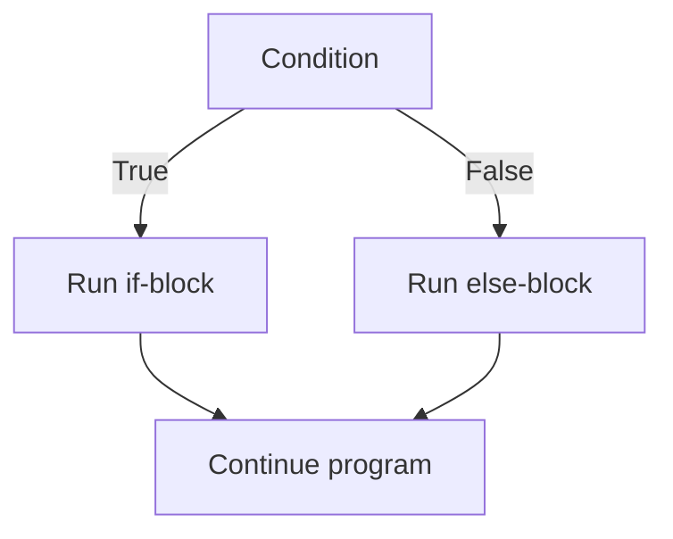

# Conditional Statements in Python

## Introduction

**Conditional statements** let a program choose which code to execute depending on whether a condition is true or false. They control the **flow** of execution: instead of running every line from top to bottom, the interpreter takes one of several branches.

```python
age = 20
if age >= 18:
    print("Adult")
else:
    print("Minor")
```

**Main forms:**

|**Form**|**Purpose**|
|---|---|
|`if`|Run code only if a condition is true|
|`if ... else`|Choose between two branches|
|`if ... elif ... else`|Choose between many branches|
|Conditional expression|One-line choice inside an expression|
|`match ... case`|Structural pattern matching (Python 3.10+)|



---

## Indentation and Blocks

Python defines blocks by **indentation**, not by braces.

- A statement that ends with `:` opens a block.
- All lines of the block must have the **same indentation** (PEP 8: 4 spaces).
- Mixing tabs and spaces raises `TabError` / `IndentationError`.

```python
if True:
    print("inside")      # part of the block
    print("still inside")
print("outside")          # not part of the block
```

```python
if True:
print("no indent")        # IndentationError: expected an indented block
```

- A block cannot be empty; use `pass` as a placeholder.

```python
if x > 0:
    pass                  # do nothing (TODO)
```

---

## The `if` Statement

```python
if condition:
    statements
```

- The condition is evaluated; if it is **truthy**, the block runs; otherwise it is skipped.
- Parentheses around the condition are not needed.

```python
temperature = 30
if temperature > 25:
    print("It's hot")

if (temperature > 25):    # works, but parentheses are redundant
    print("It's hot")
```

---

## The `if ... else` Statement

```python
if condition:
    statements_if_true
else:
    statements_if_false
```

- Exactly **one** of the two blocks always runs.
- `else` has **no condition**.

```python
number = 7
if number % 2 == 0:
    print("Even")
else:
    print("Odd")
```

---

## The `if ... elif ... else` Chain

```python
if condition1:
    ...
elif condition2:
    ...
elif condition3:
    ...
else:
    ...
```

- Conditions are checked **from top to bottom**.
- The **first** true condition runs its block; the rest are **skipped**.
- `else` is optional and runs only if none of the conditions was true.
- There is no `else if` or `elseif` in Python; the keyword is `elif`.

```python
score = 85

if score >= 90:
    grade = "A"
elif score >= 80:
    grade = "B"
elif score >= 70:
    grade = "C"
else:
    grade = "F"

print(grade)    # B
```

**Order matters:**

```python
score = 95
if score >= 70:
    print("C")        # runs first, the others are never checked
elif score >= 90:
    print("A")        # never reached
```

Put the **most specific** conditions first.

---

## Conditions

A condition can be any expression. Python evaluates its **truthiness**.

### Comparison Operators

|**Operator**|**Meaning**|
|---|---|
|`==`|Equal to|
|`!=`|Not equal to|
|`>`, `<`|Greater / less than|
|`>=`, `<=`|Greater / less or equal|

```python
if x == 5: ...
if 1 < x < 10: ...         # chained comparison
```

### Logical Operators

|**Operator**|**Meaning**|**Example**|
|---|---|---|
|`and`|Both conditions are true|`age >= 18 and has_id`|
|`or`|At least one is true|`is_admin or is_owner`|
|`not`|Inverts the condition|`not is_banned`|

```python
if age >= 18 and has_ticket:
    print("Enter")

if day == "Sat" or day == "Sun":
    print("Weekend")

if not items:
    print("List is empty")
```

- `and` / `or` use **short-circuit evaluation**: the second operand is evaluated only if needed.

```python
if x != 0 and 10 / x > 2:     # safe: no ZeroDivisionError when x == 0
    ...
```

### Membership and Identity

```python
if "a" in "banana": ...
if color in ("red", "green", "blue"): ...
if key not in my_dict: ...

if value is None: ...
if value is not None: ...
```

- Use `is` / `is not` for `None`; use `==` for values.

### Truthy and Falsy Values

**Falsy:** `False`, `None`, `0`, `0.0`, `""`, `[]`, `()`, `{}`, `set()`. **Everything else is truthy.**

```python
name = ""
if name:
    print("Hello,", name)
else:
    print("Name is empty")          # runs

items = [1, 2]
if items:                           # preferred over: if len(items) > 0
    print("Has items")
```

**Pythonic checks:**

|**Instead of**|**Write**|
|---|---|
|`if x == True:`|`if x:`|
|`if x == False:`|`if not x:`|
|`if len(items) > 0:`|`if items:`|
|`if x == None:`|`if x is None:`|
|`if x == 1 or x == 2:`|`if x in (1, 2):`|

**Pitfall — `0` is falsy:**

```python
count = 0
if count:                  # False! 0 is falsy
    ...
if count is not None:      # correct way to test "has a value"
    ...
```

---

## Nested Conditions

An `if` inside another `if`.

```python
age = 25
has_license = True

if age >= 18:
    if has_license:
        print("Can drive")
    else:
        print("Get a license first")
else:
    print("Too young")
```

**Flatten with `and`** when there are no separate `else` branches:

```python
if age >= 18 and has_license:
    print("Can drive")
```

**Use guard clauses (early return)** to avoid deep nesting:

```python
def process(user):
    if user is None:
        return "No user"
    if not user.is_active:
        return "Inactive"
    return "OK"              # main logic stays at the top level
```

- Avoid more than 2-3 levels of nesting; readability suffers.

---

## Conditional Expression (Ternary Operator)

```python
value = a if condition else b
```

- Evaluates `condition`; returns `a` if true, otherwise `b`.
- It is an **expression**, so it can be used in assignments, arguments, and f-strings.

```python
status = "adult" if age >= 18 else "minor"
abs_x = x if x >= 0 else -x
print("even" if n % 2 == 0 else "odd")
f"You have {n} item{'s' if n != 1 else ''}"

# Nested (avoid deep chains)
grade = "A" if score >= 90 else "B" if score >= 80 else "C"
```

**`and` / `or` as a shortcut for defaults:**

```python
name = input_name or "Guest"      # "Guest" if input_name is falsy
```

- Careful: `or` replaces **any** falsy value (`0`, `""`), not only `None`.

---

## Pattern Matching: `match ... case` (Python 3.10+)

A cleaner alternative to long `if ... elif` chains that compare one value.

```python
command = "stop"

match command:
    case "start":
        print("Starting")
    case "stop":
        print("Stopping")
    case "pause" | "wait":          # OR-pattern
        print("Pausing")
    case _:                          # default (wildcard)
        print("Unknown command")
```

### Pattern Types

```python
match point:
    case (0, 0):                     # sequence pattern
        print("Origin")
    case (x, 0):                     # capture: binds x
        print(f"On X axis at {x}")
    case (x, y) if x == y:           # guard condition
        print("Diagonal")
    case (x, y):
        print(f"Point {x}, {y}")
```

```python
match response:
    case {"status": 200, "data": data}:        # mapping pattern
        print(data)
    case {"status": 404}:
        print("Not found")
    case int(n) if n > 0:                      # class pattern + guard
        print("Positive int")
    case [first, *rest]:                       # sequence with star
        print(first, rest)
```

**Key points:**

- `_` is the wildcard; it matches anything and is usually last.
- Names in patterns **capture** values (they do not compare with variables).
- To compare with a constant name, use a dotted name: `case Color.RED:`.
- `|` combines alternatives; `if` adds a guard.
- Unlike `switch` in C/Java, there is **no fall-through** and no `break` needed.
- Not available before Python 3.10.

### Dictionary Dispatch (alternative for older versions)

```python
actions = {
    "start": start,
    "stop": stop,
}
actions.get(command, unknown)()
```

---

## Common Patterns

### Validating Input

```python
age_text = input("Age: ").strip()

if not age_text:
    print("Empty input")
elif not age_text.isdigit():
    print("Not a number")
elif int(age_text) < 0:
    print("Negative age")
else:
    print("OK")
```

### Min / Max / Clamp

```python
biggest = a if a > b else b           # or max(a, b)
value = max(low, min(value, high))    # clamp to range
```

### FizzBuzz

```python
for i in range(1, 16):
    if i % 15 == 0:
        print("FizzBuzz")
    elif i % 3 == 0:
        print("Fizz")
    elif i % 5 == 0:
        print("Buzz")
    else:
        print(i)
```

### Leap Year

```python
if (year % 4 == 0 and year % 100 != 0) or year % 400 == 0:
    print("Leap year")
```

### Mapping a Value to a Category

```python
if bmi < 18.5:
    category = "Underweight"
elif bmi < 25:
    category = "Normal"
elif bmi < 30:
    category = "Overweight"
else:
    category = "Obese"
```

- Because earlier branches already excluded lower values, each `elif` needs only the upper bound.

---

## Common Pitfalls

|**Mistake**|**Problem / Fix**|
|---|---|
|`if x = 5:`|`SyntaxError`; use `==` for comparison|
|`if x == 1 or 2:`|Always true (`2` is truthy); write `x == 1 or x == 2` or `x in (1, 2)`|
|`if x == None:`|Works, but use `if x is None:`|
|`if x == True:`|Redundant; write `if x:`|
|Missing `:` after the condition|`SyntaxError`|
|Inconsistent indentation|`IndentationError`; use 4 spaces|
|`else if` instead of `elif`|`SyntaxError`|
|Wrong order in `elif` chain|A broad condition shadows narrower ones; put specific first|
|`if count:` when `0` is valid|`0` is falsy; use `if count is not None:`|
|Comparing floats with `==`|Precision errors; use `math.isclose()`|
|Deeply nested `if` blocks|Hard to read; use `and`, guard clauses, or `match`|
|`if a < b > c:`|Valid chain meaning `a < b and b > c`; make sure it is intended|
|`a and b or c` as a ternary|Breaks when `b` is falsy; use `b if a else c`|
|Empty block without `pass`|`IndentationError`; add `pass`|

---

## Summary

- Conditional statements choose which code runs based on a **condition**; blocks are defined by **indentation** and a trailing `:`.
- **Forms:** `if`, `if ... else`, `if ... elif ... else`; the **first** true branch runs and the rest are skipped.
- Conditions use **comparison** (`== != < > <= >=`), **logical** (`and or not`), **membership** (`in`) and **identity** (`is`) operators; chained comparisons like `1 < x < 10` are allowed.
- Any object has **truthiness**: `0`, `""`, `[]`, `{}`, `None`, `False` are falsy; prefer `if items:` over `if len(items) > 0:`.
- `and` / `or` **short-circuit**; use `is None` for `None`, `x in (1, 2)` for multiple values.
- **Ternary:** `a if condition else b`; do not nest it deeply.
- **`match ... case`** (3.10+) provides pattern matching with captures, guards, `|` alternatives and `_` wildcard; no fall-through.
- Keep code flat: combine conditions with `and`, use **guard clauses**, and avoid more than 2-3 nesting levels.