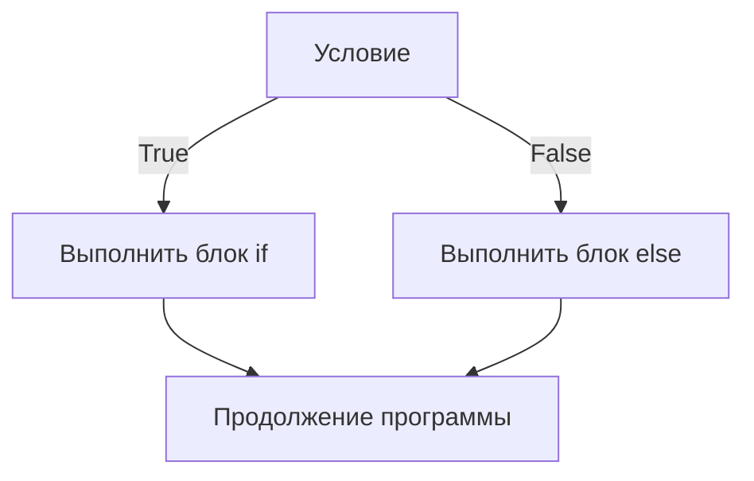

# Условные инструкции в Python

## Введение

**Условные инструкции** позволяют программе выбирать, какой код выполнять, в зависимости от того, истинно условие или ложно. Они управляют **потоком** выполнения: вместо того чтобы выполнять все строки сверху вниз, интерпретатор идёт по одной из нескольких веток.

```python
age = 20
if age >= 18:
    print("Adult")
else:
    print("Minor")
```

**Основные формы:**

|**Форма**|**Назначение**|
|---|---|
|`if`|Выполнить код только если условие истинно|
|`if ... else`|Выбрать одну из двух веток|
|`if ... elif ... else`|Выбрать одну из многих веток|
|Условное выражение|Выбор в одну строку внутри выражения|
|`match ... case`|Структурное сопоставление с образцом (Python 3.10+)|



---

## Отступы и блоки

Python определяет блоки **отступами**, а не фигурными скобками.

- Инструкция, оканчивающаяся на `:`, открывает блок.
- Все строки блока должны иметь **одинаковый отступ** (PEP 8: 4 пробела).
- Смешивание табуляции и пробелов вызывает `TabError` / `IndentationError`.

```python
if True:
    print("inside")      # часть блока
    print("still inside")
print("outside")          # не часть блока
```

```python
if True:
print("no indent")        # IndentationError: expected an indented block
```

- Блок не может быть пустым; используйте `pass` как заглушку.

```python
if x > 0:
    pass                  # ничего не делать (TODO)
```

---

## Инструкция `if`

```python
if condition:
    statements
```

- Условие вычисляется; если оно **истинно**, блок выполняется, иначе пропускается.
- Скобки вокруг условия не нужны.

```python
temperature = 30
if temperature > 25:
    print("It's hot")

if (temperature > 25):    # работает, но скобки лишние
    print("It's hot")
```

---

## Инструкция `if ... else`

```python
if condition:
    statements_if_true
else:
    statements_if_false
```

- Всегда выполняется **ровно один** из двух блоков.
- У `else` **нет условия**.

```python
number = 7
if number % 2 == 0:
    print("Even")
else:
    print("Odd")
```

---

## Цепочка `if ... elif ... else`

```python
if condition1:
    ...
elif condition2:
    ...
elif condition3:
    ...
else:
    ...
```

- Условия проверяются **сверху вниз**.
- Блок **первого** истинного условия выполняется, остальные **пропускаются**.
- `else` необязателен и выполняется, только если ни одно условие не было истинным.
- В Python нет `else if` и `elseif`; ключевое слово — `elif`.

```python
score = 85

if score >= 90:
    grade = "A"
elif score >= 80:
    grade = "B"
elif score >= 70:
    grade = "C"
else:
    grade = "F"

print(grade)    # B
```

**Порядок имеет значение:**

```python
score = 95
if score >= 70:
    print("C")        # выполнится первым, остальные не проверяются
elif score >= 90:
    print("A")        # недостижимо
```

Ставьте **наиболее специфичные** условия первыми.

---

## Условия

Условием может быть любое выражение. Python вычисляет его **истинность**.

### Операторы сравнения

|**Оператор**|**Значение**|
|---|---|
|`==`|Равно|
|`!=`|Не равно|
|`>`, `<`|Больше / меньше|
|`>=`, `<=`|Больше или равно / меньше или равно|

```python
if x == 5: ...
if 1 < x < 10: ...         # цепочка сравнений
```

### Логические операторы

|**Оператор**|**Значение**|**Пример**|
|---|---|---|
|`and`|Оба условия истинны|`age >= 18 and has_id`|
|`or`|Хотя бы одно истинно|`is_admin or is_owner`|
|`not`|Инвертирует условие|`not is_banned`|

```python
if age >= 18 and has_ticket:
    print("Enter")

if day == "Sat" or day == "Sun":
    print("Weekend")

if not items:
    print("List is empty")
```

- `and` / `or` используют **короткое замыкание**: второй операнд вычисляется, только если это необходимо.

```python
if x != 0 and 10 / x > 2:     # безопасно: нет ZeroDivisionError при x == 0
    ...
```

### Принадлежность и идентичность

```python
if "a" in "banana": ...
if color in ("red", "green", "blue"): ...
if key not in my_dict: ...

if value is None: ...
if value is not None: ...
```

- Для `None` используйте `is` / `is not`; для значений — `==`.

### Истинные и ложные значения (Truthy / Falsy)

**Ложные:** `False`, `None`, `0`, `0.0`, `""`, `[]`, `()`, `{}`, `set()`. **Всё остальное — истинное.**

```python
name = ""
if name:
    print("Hello,", name)
else:
    print("Name is empty")          # выполнится

items = [1, 2]
if items:                           # лучше, чем: if len(items) > 0
    print("Has items")
```

**Pythonic-проверки:**

|**Вместо**|**Пишите**|
|---|---|
|`if x == True:`|`if x:`|
|`if x == False:`|`if not x:`|
|`if len(items) > 0:`|`if items:`|
|`if x == None:`|`if x is None:`|
|`if x == 1 or x == 2:`|`if x in (1, 2):`|

**Ловушка — `0` ложен:**

```python
count = 0
if count:                  # False! 0 — ложное значение
    ...
if count is not None:      # правильный способ проверить «значение есть»
    ...
```

---

## Вложенные условия

`if` внутри другого `if`.

```python
age = 25
has_license = True

if age >= 18:
    if has_license:
        print("Can drive")
    else:
        print("Get a license first")
else:
    print("Too young")
```

**Упростите через `and`**, если отдельных веток `else` нет:

```python
if age >= 18 and has_license:
    print("Can drive")
```

**Используйте охранные условия (guard clauses, ранний возврат)**, чтобы не создавать глубокую вложенность:

```python
def process(user):
    if user is None:
        return "No user"
    if not user.is_active:
        return "Inactive"
    return "OK"              # основная логика остаётся на верхнем уровне
```

- Избегайте более 2–3 уровней вложенности; страдает читаемость.

---

## Условное выражение (тернарный оператор)

```python
value = a if condition else b
```

- Вычисляется `condition`; возвращается `a`, если оно истинно, иначе `b`.
- Это **выражение**, поэтому его можно использовать в присваиваниях, аргументах и f-строках.

```python
status = "adult" if age >= 18 else "minor"
abs_x = x if x >= 0 else -x
print("even" if n % 2 == 0 else "odd")
f"You have {n} item{'s' if n != 1 else ''}"

# Вложенное (избегайте длинных цепочек)
grade = "A" if score >= 90 else "B" if score >= 80 else "C"
```

**`and` / `or` как короткий путь для значений по умолчанию:**

```python
name = input_name or "Guest"      # "Guest", если input_name ложно
```

- Осторожно: `or` заменяет **любое** ложное значение (`0`, `""`), а не только `None`.

---

## Сопоставление с образцом: `match ... case` (Python 3.10+)

Более чистая альтернатива длинным цепочкам `if ... elif`, сравнивающим одно значение.

```python
command = "stop"

match command:
    case "start":
        print("Starting")
    case "stop":
        print("Stopping")
    case "pause" | "wait":          # OR-образец
        print("Pausing")
    case _:                          # по умолчанию (wildcard)
        print("Unknown command")
```

### Виды образцов

```python
match point:
    case (0, 0):                     # образец-последовательность
        print("Origin")
    case (x, 0):                     # захват: связывает x
        print(f"On X axis at {x}")
    case (x, y) if x == y:           # охранное условие (guard)
        print("Diagonal")
    case (x, y):
        print(f"Point {x}, {y}")
```

```python
match response:
    case {"status": 200, "data": data}:        # образец-отображение (словарь)
        print(data)
    case {"status": 404}:
        print("Not found")
    case int(n) if n > 0:                      # образец-класс + guard
        print("Positive int")
    case [first, *rest]:                       # последовательность со звёздочкой
        print(first, rest)
```

**Ключевые моменты:**

- `_` — это wildcard; совпадает с чем угодно и обычно стоит последним.
- Имена в образцах **захватывают** значения (а не сравниваются с переменными).
- Чтобы сравнить с константой, используйте имя с точкой: `case Color.RED:`.
- `|` объединяет альтернативы; `if` добавляет охранное условие.
- В отличие от `switch` в C/Java, **нет проваливания** (fall-through) и `break` не нужен.
- Недоступно до Python 3.10.

### Диспетчеризация через словарь (альтернатива для старых версий)

```python
actions = {
    "start": start,
    "stop": stop,
}
actions.get(command, unknown)()
```

---

## Типичные паттерны

### Проверка ввода

```python
age_text = input("Age: ").strip()

if not age_text:
    print("Empty input")
elif not age_text.isdigit():
    print("Not a number")
elif int(age_text) < 0:
    print("Negative age")
else:
    print("OK")
```

### Минимум / максимум / ограничение диапазоном

```python
biggest = a if a > b else b           # или max(a, b)
value = max(low, min(value, high))    # ограничить диапазоном
```

### FizzBuzz

```python
for i in range(1, 16):
    if i % 15 == 0:
        print("FizzBuzz")
    elif i % 3 == 0:
        print("Fizz")
    elif i % 5 == 0:
        print("Buzz")
    else:
        print(i)
```

### Високосный год

```python
if (year % 4 == 0 and year % 100 != 0) or year % 400 == 0:
    print("Leap year")
```

### Отнесение значения к категории

```python
if bmi < 18.5:
    category = "Underweight"
elif bmi < 25:
    category = "Normal"
elif bmi < 30:
    category = "Overweight"
else:
    category = "Obese"
```

- Поскольку предыдущие ветки уже отсекли меньшие значения, в каждом `elif` нужна только верхняя граница.

---

## Типичные ошибки

|**Ошибка**|**Проблема / Исправление**|
|---|---|
|`if x = 5:`|`SyntaxError`; для сравнения используйте `==`|
|`if x == 1 or 2:`|Всегда истинно (`2` истинно); пишите `x == 1 or x == 2` или `x in (1, 2)`|
|`if x == None:`|Работает, но лучше `if x is None:`|
|`if x == True:`|Избыточно; пишите `if x:`|
|Пропущенное `:` после условия|`SyntaxError`|
|Непоследовательные отступы|`IndentationError`; используйте 4 пробела|
|`else if` вместо `elif`|`SyntaxError`|
|Неверный порядок в цепочке `elif`|Широкое условие перекрывает узкие; ставьте специфичные первыми|
|`if count:`, когда `0` допустим|`0` ложен; используйте `if count is not None:`|
|Сравнение float через `==`|Погрешность; используйте `math.isclose()`|
|Глубоко вложенные блоки `if`|Трудно читать; используйте `and`, guard clauses или `match`|
|`if a < b > c:`|Допустимая цепочка, означающая `a < b and b > c`; убедитесь, что это задумано|
|`a and b or c` как тернарный оператор|Ломается, если `b` ложно; используйте `b if a else c`|
|Пустой блок без `pass`|`IndentationError`; добавьте `pass`|

---

## Итоги

- Условные инструкции выбирают, какой код выполнять, на основе **условия**; блоки определяются **отступами** и завершающим `:`.
- **Формы:** `if`, `if ... else`, `if ... elif ... else`; выполняется **первая** истинная ветка, остальные пропускаются.
- В условиях используются операторы **сравнения** (`== != < > <= >=`), **логические** (`and or not`), **принадлежности** (`in`) и **идентичности** (`is`); допустимы цепочки вроде `1 < x < 10`.
- У любого объекта есть **истинность**: `0`, `""`, `[]`, `{}`, `None`, `False` ложны; предпочитайте `if items:` вместо `if len(items) > 0:`.
- `and` / `or` работают с **коротким замыканием**; для `None` используйте `is None`, для нескольких значений — `x in (1, 2)`.
- **Тернарный оператор:** `a if condition else b`; не делайте его глубоко вложенным.
- **`match ... case`** (3.10+) даёт сопоставление с образцом с захватом, охранными условиями, альтернативами `|` и wildcard `_`; проваливания нет.
- Держите код плоским: объединяйте условия через `and`, используйте **guard clauses** и избегайте более 2–3 уровней вложенности.