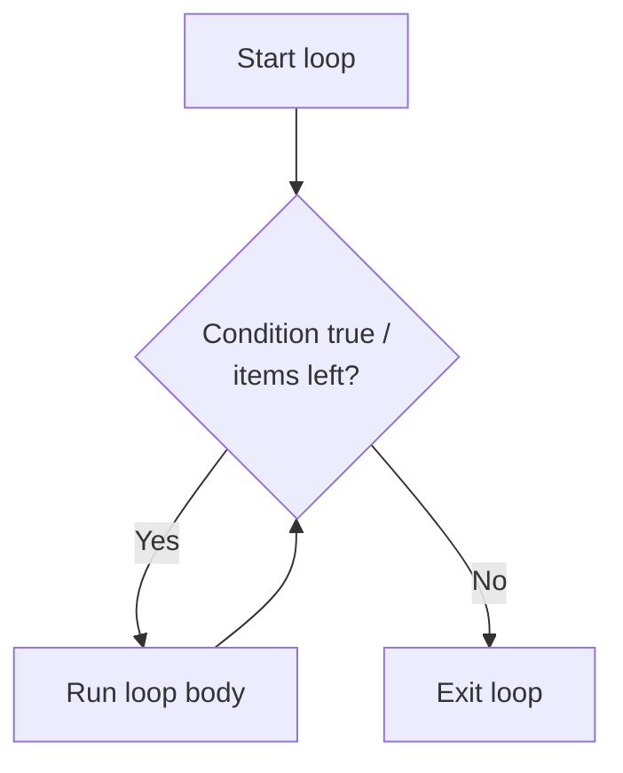

# Loops in Python: `for`, `while`, `range`

## Introduction

A **loop** repeats a block of code several times. Python has two loop statements:

|**Loop**|**Repeats...**|**Use when**|
|---|---|---|
|`for`|Once for each item of an **iterable**|You know what to iterate over (list, range...)|
|`while`|As long as a **condition** is true|You do not know the number of iterations|

```python
for i in range(3):
    print(i)          # 0, 1, 2

n = 3
while n > 0:
    print(n)          # 3, 2, 1
    n -= 1
```



**Terms:**

- **Iteration** — one pass through the loop body.
- **Iterable** — an object that can be looped over (`list`, `str`, `tuple`, `dict`, `set`, `range`, files, generators).
- **Iterator** — an object that produces items one by one.
- **Loop body** — the indented block that is repeated.

---

## The `for` Loop

```python
for item in iterable:
    statements
```

- `item` is a variable that receives the next element on every iteration.
- The loop ends when the iterable is exhausted.
- The loop variable **stays defined** after the loop (with the last value).

```python
for fruit in ["apple", "banana", "cherry"]:
    print(fruit)

for ch in "Python":          # strings are iterable
    print(ch)

for x in (1, 2, 3):          # tuples
    print(x * 2)
```

### Iterating over Different Types

|**Type**|**What you get**|**Example**|
|---|---|---|
|`list`|Elements|`for x in [1, 2, 3]`|
|`str`|Characters|`for ch in "abc"`|
|`tuple`|Elements|`for x in (1, 2)`|
|`set`|Elements (arbitrary order)|`for x in {1, 2}`|
|`dict`|**Keys**|`for k in d`|
|`range`|Numbers|`for i in range(5)`|
|file|Lines|`for line in open("f.txt")`|

### Iterating over a Dictionary

```python
d = {"a": 1, "b": 2}

for key in d:                    # keys (same as d.keys())
    print(key)

for value in d.values():         # values
    print(value)

for key, value in d.items():     # key-value pairs
    print(key, value)
```

### Tuple Unpacking in `for`

```python
pairs = [(1, "one"), (2, "two")]
for num, word in pairs:
    print(num, word)

for i, (a, b) in enumerate([(1, 2), (3, 4)]):
    print(i, a, b)
```

### Index-Based Iteration

```python
items = ["a", "b", "c"]

# Not Pythonic
for i in range(len(items)):
    print(i, items[i])

# Pythonic: enumerate
for i, item in enumerate(items):
    print(i, item)

for i, item in enumerate(items, start=1):    # start numbering from 1
    print(i, item)
```

---

## The `range()` Function

`range` produces an **immutable sequence of integers** lazily (numbers are not stored in memory).

|**Form**|**Meaning**|**Result**|
|---|---|---|
|`range(stop)`|`0` up to `stop - 1`|`range(5)` -> `0,1,2,3,4`|
|`range(start, stop)`|`start` up to `stop - 1`|`range(2, 5)` -> `2,3,4`|
|`range(start, stop, step)`|Every `step`-th number|`range(0, 10, 3)` -> `0,3,6,9`|

**Key points:**

- `stop` is **excluded**.
- `step` can be **negative** (count down); it cannot be `0` (`ValueError`).
- Only **integers** are allowed; for floats use a loop with calculation or `numpy.arange`.
- If the range is empty (e.g. `range(5, 2)`), the loop body never runs.

```python
list(range(5))             # [0, 1, 2, 3, 4]
list(range(2, 6))          # [2, 3, 4, 5]
list(range(0, 10, 2))      # [0, 2, 4, 6, 8]
list(range(10, 0, -2))     # [10, 8, 6, 4, 2]
list(range(5, 2))          # []
list(range(5, 0, -1))      # [5, 4, 3, 2, 1]
```

**`range` is a sequence:**

```python
r = range(10)
len(r)          # 10
r[3]            # 3
r[-1]           # 9
r[2:5]          # range(2, 5)
5 in r          # True (fast, O(1))
```

**Memory:** `range(10**9)` takes a few dozen bytes; `list(range(10**9))` would need gigabytes.

### Typical Uses

```python
for _ in range(3):             # repeat N times, variable not needed
    print("Hello")

for i in range(1, 11):         # 1..10
    print(i)

for i in range(10, 0, -1):     # countdown 10..1
    print(i)

total = sum(range(1, 101))     # 5050
```

- `_` is a conventional name for an unused variable.

### Floating-Point Steps

```python
for i in range(5):
    x = i * 0.5                # 0.0, 0.5, 1.0, 1.5, 2.0
    print(x)
```

---

## The `while` Loop

```python
while condition:
    statements
```

- The condition is checked **before every iteration**.
- If it is false on the first check, the body never runs.
- The body must **change something** that affects the condition; otherwise the loop is **infinite**.

```python
count = 1
while count <= 5:
    print(count)
    count += 1            # without this: infinite loop
```

### Typical Patterns

**Counter-controlled:**

```python
n = 10
while n > 0:
    print(n)
    n -= 2
```

**Sentinel-controlled (until user types a value):**

```python
text = input("Enter text ('quit' to stop): ")
while text != "quit":
    print("You typed:", text)
    text = input("Enter text ('quit' to stop): ")
```

**Infinite loop with `break` (very common):**

```python
while True:
    answer = input("Continue? (y/n): ")
    if answer == "n":
        break
    print("Going on...")
```

**Processing until a collection is empty:**

```python
stack = [1, 2, 3]
while stack:                   # truthy while non-empty
    print(stack.pop())
```

**Walrus operator in `while`:**

```python
while (line := input("> ")) != "quit":
    print(line)
```

### `for` vs `while`

|**Criterion**|**`for`**|**`while`**|
|---|---|---|
|**Iterations known**|Yes (iterable / range)|Not necessarily|
|**Stops when**|Iterable is exhausted|Condition becomes false|
|**Risk of infinite loop**|Low|High if the condition never changes|
|**Typical use**|Collections, counting|Input loops, retries, algorithms|
|**Readability**|Higher for sequences|Higher for "until X happens"|

Any `for` can be rewritten with `while`, but not always vice versa; choose `for` whenever you iterate over something.

---

## Loop Control: `break`, `continue`, `pass`

|**Statement**|**Effect**|
|---|---|
|`break`|Exit the **innermost** loop immediately|
|`continue`|Skip the rest of the body and go to the **next iteration**|
|`pass`|Do nothing (placeholder)|

```python
for i in range(10):
    if i == 5:
        break              # stop the loop at 5
    print(i)               # 0..4

for i in range(6):
    if i % 2 == 0:
        continue           # skip even numbers
    print(i)               # 1, 3, 5
```

- In nested loops, `break` and `continue` affect **only the innermost loop**.
- In `while`, make sure `continue` does not skip the line that updates the counter (infinite loop).

```python
i = 0
while i < 5:
    if i == 2:
        continue           # BUG: i is never incremented -> infinite loop
    i += 1
```

---

## The `else` Clause of Loops

`else` runs **only if the loop finished normally** (was **not** stopped by `break`).

```python
for n in range(2, 10):
    if n == 7:
        print("Found 7")
        break
else:
    print("Not found")      # runs only if break never happened
```

**Typical use — search:**

```python
def is_prime(n):
    if n < 2:
        return False
    for d in range(2, int(n ** 0.5) + 1):
        if n % d == 0:
            break
    else:
        return True         # no divisor found
    return False
```

- Works for `while` too.
- Think of it as "**no-break**" clause.

---

## Nested Loops

A loop inside another loop. The inner loop runs **fully** for each iteration of the outer one.

```python
for i in range(1, 4):
    for j in range(1, 4):
        print(i * j, end=" ")
    print()
```

```
1 2 3
2 4 6
3 6 9
```

**Number of iterations:** outer x inner (here `3 * 3 = 9`). Time complexity grows quickly: two nested loops over `n` items give O(n^2).

**Pattern printing:**

```python
for i in range(1, 5):
    print("*" * i)
```

```
*
**
***
****
```

**Breaking out of two loops:**

```python
# 1) with a flag
found = False
for row in matrix:
    for x in row:
        if x == target:
            found = True
            break
    if found:
        break

# 2) with a function and return (cleaner)
def find(matrix, target):
    for row in matrix:
        for x in row:
            if x == target:
                return True
    return False
```

---

## Useful Built-in Helpers

|**Function**|**Purpose**|**Example**|
|---|---|---|
|`enumerate(it, start=0)`|Index + item|`for i, x in enumerate(items)`|
|`zip(a, b, ...)`|Iterate several iterables in parallel|`for x, y in zip(xs, ys)`|
|`reversed(seq)`|Iterate backwards|`for x in reversed(items)`|
|`sorted(it)`|Iterate in sorted order (returns new list)|`for x in sorted(items)`|
|`range(...)`|Integer sequence|`for i in range(5)`|
|`len`, `sum`, `min`, `max`|Aggregates over iterables|`sum(x for x in items)`|
|`any(it)` / `all(it)`|True if any / all items are truthy|`any(x > 5 for x in nums)`|

```python
names = ["Ali", "Bek", "Cat"]
ages = [20, 21, 22]

for name, age in zip(names, ages):
    print(name, age)

for item in reversed([1, 2, 3]):
    print(item)                      # 3, 2, 1

for i, name in enumerate(names, 1):
    print(f"{i}. {name}")
```

- `zip` stops at the **shortest** iterable (use `itertools.zip_longest` or `zip(..., strict=True)` in 3.10+ for other behavior).

---

## Modifying a Collection While Iterating

Do **not** add or remove items of a list/dict/set while looping over it: it skips elements or raises errors.

```python
nums = [1, 2, 3, 4, 5, 6]

# Wrong: skips elements
for n in nums:
    if n % 2 == 0:
        nums.remove(n)

# Right: iterate over a copy
for n in nums[:]:
    if n % 2 == 0:
        nums.remove(n)

# Better: build a new list
nums = [n for n in nums if n % 2 != 0]
```

```python
d = {"a": 1, "b": 2}
for k in d:
    d["c"] = 3          # RuntimeError: dictionary changed size during iteration
```

- Changing **values** of existing keys while iterating a dict is allowed; changing its **size** is not.

---

## Comprehensions (Brief)

A compact form of a loop that builds a collection.

```python
squares = [x ** 2 for x in range(5)]               # [0, 1, 4, 9, 16]
evens = [x for x in range(10) if x % 2 == 0]       # [0, 2, 4, 6, 8]
pairs = [(x, y) for x in range(2) for y in range(2)]
d = {x: x ** 2 for x in range(3)}                  # {0: 0, 1: 1, 2: 4}
s = {x % 3 for x in range(10)}                     # {0, 1, 2}
gen = (x ** 2 for x in range(5))                   # generator, lazy
```

Use comprehensions for simple transformations and filters; use a regular loop when the logic is complex or has side effects.

---

## Common Patterns

### Sum and Counting

```python
total = 0
for x in [3, 5, 7]:
    total += x            # or: sum([3, 5, 7])

count = 0
for ch in "banana":
    if ch == "a":
        count += 1        # or: "banana".count("a")
```

### Finding Max Manually

```python
nums = [4, 9, 2, 7]
biggest = nums[0]
for n in nums[1:]:
    if n > biggest:
        biggest = n       # or: max(nums)
```

### Building a List / String

```python
result = []
for i in range(5):
    result.append(i * i)

words = ["a", "b", "c"]
text = "".join(words)     # do not use s += in a long loop
```

### Multiplication Table

```python
for i in range(1, 4):
    print(" ".join(f"{i * j:2}" for j in range(1, 4)))
```

### Retry with Limit

```python
attempts = 0
while attempts < 3:
    password = input("Password: ")
    if password == "secret":
        print("Access granted")
        break
    attempts += 1
else:
    print("Too many attempts")
```

### Factorial and Fibonacci

```python
n, result = 5, 1
for i in range(2, n + 1):
    result *= i           # 120

a, b = 0, 1
for _ in range(10):
    print(a, end=" ")     # 0 1 1 2 3 5 8 13 21 34
    a, b = b, a + b
```

---

## Common Pitfalls

|**Mistake**|**Problem / Fix**|
|---|---|
|Forgetting to update the counter in `while`|Infinite loop; change the variable used in the condition|
|`range(1, 10)` expecting `10` included|`stop` is excluded; use `range(1, 11)`|
|`range(5, 1)` expecting a countdown|Empty range; use `range(5, 1, -1)`|
|`range(0, 10, 0)`|`ValueError`; step cannot be `0`|
|`range(0.5, 5)` or float step|`TypeError`; `range` accepts integers only|
|`for i in range(len(x))` with `x[i]`|Not Pythonic; use `for item in x` or `enumerate`|
|Removing items from a list while looping|Items are skipped; iterate over a copy or use a comprehension|
|Changing dict size while iterating|`RuntimeError`; iterate over `list(d)` or build a new dict|
|`continue` before the counter update|Infinite loop in `while`|
|Expecting `break` to exit all nested loops|Only the innermost loop stops; use a flag or a function with `return`|
|Using the loop variable after an empty loop|`NameError` (variable was never assigned)|
|`else` after a loop expected to run on `break`|It runs only when there was **no** `break`|
|Building a string with `+=` in a big loop|Slow; collect parts in a list and use `"".join(...)`|
|Reusing the same name for nested loop vars|Inner loop overwrites the outer variable; use different names|
|Late binding in closures inside loops|`lambda: i` all see the last `i`; use `lambda i=i: i`|

---

## Summary

- A **loop** repeats code; `for` iterates over an **iterable**, `while` repeats **while a condition is true**.
- `for item in iterable:` works with lists, strings, tuples, sets, dicts (keys), `range`, files; use `enumerate` for indexes, `zip` for parallel iteration, `.items()` for dict pairs.
- `range(stop)`, `range(start, stop)`, `range(start, stop, step)` produce **lazy integer sequences**; `stop` is **excluded**, `step` may be negative but not `0`, only integers are allowed.
- `while` needs a condition that eventually becomes false; `while True` + `break` is a common pattern for input and retries.
- **`break`** exits the innermost loop, **`continue`** skips to the next iteration, **`pass`** does nothing.
- **`else`** on a loop runs only if the loop ended **without `break`** (handy for searches).
- **Nested loops** multiply iterations (O(n^2)); `break` affects only the innermost loop.
- Do not modify a collection while iterating over it; use a copy or a comprehension.
- Prefer built-ins and comprehensions (`sum`, `max`, `any`, `all`, `[x for x in ...]`) over manual loops for simple tasks.