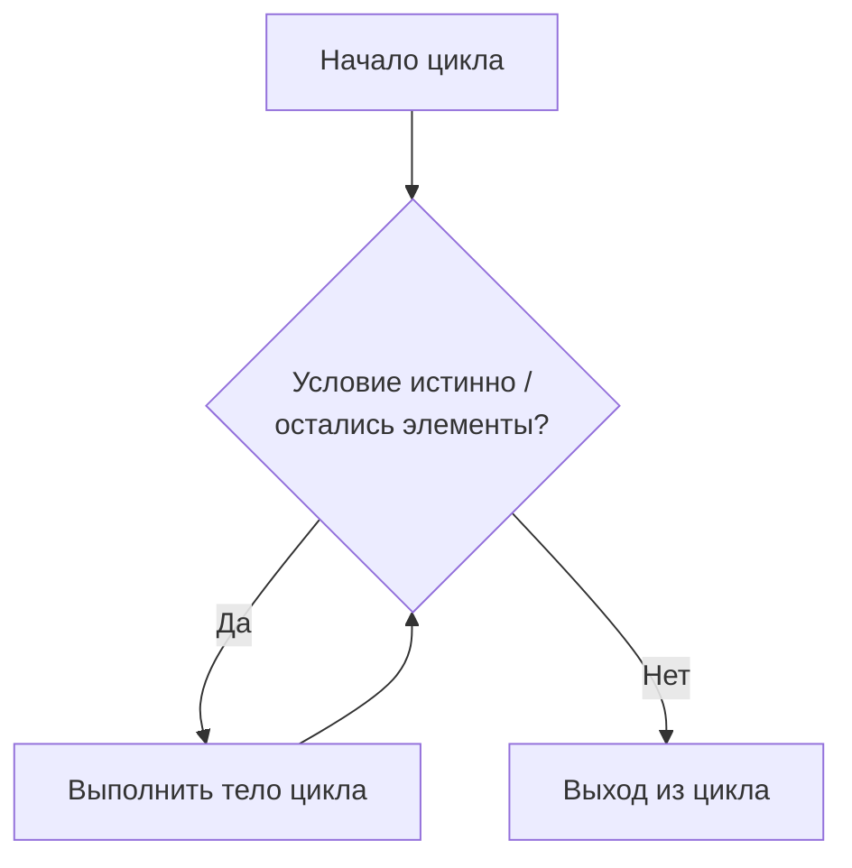

# Циклы в Python: `for`, `while`, `range`

## Введение

**Цикл** повторяет блок кода несколько раз. В Python есть две инструкции цикла:

|**Цикл**|**Повторяет...**|**Когда использовать**|
|---|---|---|
|`for`|Один раз для каждого элемента **итерируемого объекта**|Вы знаете, по чему итерировать (список, range...)|
|`while`|Пока **условие** истинно|Вы не знаете число итераций|

```python
for i in range(3):
    print(i)          # 0, 1, 2

n = 3
while n > 0:
    print(n)          # 3, 2, 1
    n -= 1
```



**Термины:**

- **Итерация** — один проход по телу цикла.
- **Итерируемый объект (iterable)** — объект, по которому можно проходить циклом (`list`, `str`, `tuple`, `dict`, `set`, `range`, файлы, генераторы).
- **Итератор (iterator)** — объект, который выдаёт элементы по одному.
- **Тело цикла** — блок с отступом, который повторяется.

---

## Цикл `for`

```python
for item in iterable:
    statements
```

- `item` — переменная, получающая следующий элемент на каждой итерации.
- Цикл заканчивается, когда итерируемый объект исчерпан.
- Переменная цикла **остаётся определённой** после цикла (с последним значением).

```python
for fruit in ["apple", "banana", "cherry"]:
    print(fruit)

for ch in "Python":          # строки итерируемы
    print(ch)

for x in (1, 2, 3):          # кортежи
    print(x * 2)
```

### Итерация по разным типам

|**Тип**|**Что получаем**|**Пример**|
|---|---|---|
|`list`|Элементы|`for x in [1, 2, 3]`|
|`str`|Символы|`for ch in "abc"`|
|`tuple`|Элементы|`for x in (1, 2)`|
|`set`|Элементы (произвольный порядок)|`for x in {1, 2}`|
|`dict`|**Ключи**|`for k in d`|
|`range`|Числа|`for i in range(5)`|
|файл|Строки|`for line in open("f.txt")`|

### Итерация по словарю

```python
d = {"a": 1, "b": 2}

for key in d:                    # ключи (то же, что d.keys())
    print(key)

for value in d.values():         # значения
    print(value)

for key, value in d.items():     # пары ключ-значение
    print(key, value)
```

### Распаковка кортежей в `for`

```python
pairs = [(1, "one"), (2, "two")]
for num, word in pairs:
    print(num, word)

for i, (a, b) in enumerate([(1, 2), (3, 4)]):
    print(i, a, b)
```

### Итерация по индексам

```python
items = ["a", "b", "c"]

# Не Pythonic
for i in range(len(items)):
    print(i, items[i])

# Pythonic: enumerate
for i, item in enumerate(items):
    print(i, item)

for i, item in enumerate(items, start=1):    # нумерация с 1
    print(i, item)
```

---

## Функция `range()`

`range` лениво производит **неизменяемую последовательность целых чисел** (числа не хранятся в памяти).

|**Форма**|**Значение**|**Результат**|
|---|---|---|
|`range(stop)`|От `0` до `stop - 1`|`range(5)` -> `0,1,2,3,4`|
|`range(start, stop)`|От `start` до `stop - 1`|`range(2, 5)` -> `2,3,4`|
|`range(start, stop, step)`|Каждое `step`-е число|`range(0, 10, 3)` -> `0,3,6,9`|

**Ключевые моменты:**

- `stop` **не включается**.
- `step` может быть **отрицательным** (обратный отсчёт); он не может быть `0` (`ValueError`).
- Допускаются только **целые числа**; для вещественных используйте цикл с вычислением или `numpy.arange`.
- Если диапазон пуст (например, `range(5, 2)`), тело цикла не выполняется ни разу.

```python
list(range(5))             # [0, 1, 2, 3, 4]
list(range(2, 6))          # [2, 3, 4, 5]
list(range(0, 10, 2))      # [0, 2, 4, 6, 8]
list(range(10, 0, -2))     # [10, 8, 6, 4, 2]
list(range(5, 2))          # []
list(range(5, 0, -1))      # [5, 4, 3, 2, 1]
```

**`range` — это последовательность:**

```python
r = range(10)
len(r)          # 10
r[3]            # 3
r[-1]           # 9
r[2:5]          # range(2, 5)
5 in r          # True (быстро, O(1))
```

**Память:** `range(10**9)` занимает несколько десятков байт; `list(range(10**9))` потребовал бы гигабайты.

### Типичное применение

```python
for _ in range(3):             # повторить N раз, переменная не нужна
    print("Hello")

for i in range(1, 11):         # 1..10
    print(i)

for i in range(10, 0, -1):     # обратный отсчёт 10..1
    print(i)

total = sum(range(1, 101))     # 5050
```

- `_` — условное имя для неиспользуемой переменной.

### Шаги с плавающей точкой

```python
for i in range(5):
    x = i * 0.5                # 0.0, 0.5, 1.0, 1.5, 2.0
    print(x)
```

---

## Цикл `while`

```python
while condition:
    statements
```

- Условие проверяется **перед каждой итерацией**.
- Если оно ложно при первой проверке, тело не выполняется ни разу.
- Тело должно **изменять что-то**, влияющее на условие; иначе цикл будет **бесконечным**.

```python
count = 1
while count <= 5:
    print(count)
    count += 1            # без этого: бесконечный цикл
```

### Типичные паттерны

**С управлением счётчиком:**

```python
n = 10
while n > 0:
    print(n)
    n -= 2
```

**С управлением по сигнальному значению (пока пользователь не введёт значение):**

```python
text = input("Enter text ('quit' to stop): ")
while text != "quit":
    print("You typed:", text)
    text = input("Enter text ('quit' to stop): ")
```

**Бесконечный цикл с `break` (очень распространён):**

```python
while True:
    answer = input("Continue? (y/n): ")
    if answer == "n":
        break
    print("Going on...")
```

**Обработка, пока коллекция не опустеет:**

```python
stack = [1, 2, 3]
while stack:                   # истинно, пока не пусто
    print(stack.pop())
```

**Оператор «морж» в `while`:**

```python
while (line := input("> ")) != "quit":
    print(line)
```

### `for` и `while`

|**Критерий**|**`for`**|**`while`**|
|---|---|---|
|**Число итераций известно**|Да (iterable / range)|Не обязательно|
|**Останавливается, когда**|Итерируемый объект исчерпан|Условие становится ложным|
|**Риск бесконечного цикла**|Низкий|Высокий, если условие не меняется|
|**Типичное применение**|Коллекции, подсчёт|Циклы ввода, повторные попытки, алгоритмы|
|**Читаемость**|Выше для последовательностей|Выше для «пока не произойдёт X»|

Любой `for` можно переписать через `while`, но не всегда наоборот; выбирайте `for`, когда вы по чему-то итерируете.

---

## Управление циклом: `break`, `continue`, `pass`

|**Инструкция**|**Эффект**|
|---|---|
|`break`|Немедленно выйти из **самого внутреннего** цикла|
|`continue`|Пропустить остаток тела и перейти к **следующей итерации**|
|`pass`|Ничего не делать (заглушка)|

```python
for i in range(10):
    if i == 5:
        break              # остановить цикл на 5
    print(i)               # 0..4

for i in range(6):
    if i % 2 == 0:
        continue           # пропустить чётные числа
    print(i)               # 1, 3, 5
```

- Во вложенных циклах `break` и `continue` действуют **только на самый внутренний цикл**.
- В `while` следите, чтобы `continue` не пропускал строку, обновляющую счётчик (бесконечный цикл).

```python
i = 0
while i < 5:
    if i == 2:
        continue           # БАГ: i никогда не увеличивается -> бесконечный цикл
    i += 1
```

---

## Блок `else` у циклов

`else` выполняется **только если цикл завершился нормально** (**не** был прерван `break`).

```python
for n in range(2, 10):
    if n == 7:
        print("Found 7")
        break
else:
    print("Not found")      # выполняется, только если break не сработал
```

**Типичное применение — поиск:**

```python
def is_prime(n):
    if n < 2:
        return False
    for d in range(2, int(n ** 0.5) + 1):
        if n % d == 0:
            break
    else:
        return True         # делитель не найден
    return False
```

- Работает и для `while`.
- Воспринимайте его как блок «**no-break**» (без прерывания).

---

## Вложенные циклы

Цикл внутри другого цикла. Внутренний цикл выполняется **полностью** на каждой итерации внешнего.

```python
for i in range(1, 4):
    for j in range(1, 4):
        print(i * j, end=" ")
    print()
```

```
1 2 3
2 4 6
3 6 9
```

**Число итераций:** внешний x внутренний (здесь `3 * 3 = 9`). Сложность быстро растёт: два вложенных цикла по `n` элементам дают O(n^2).

**Вывод узоров:**

```python
for i in range(1, 5):
    print("*" * i)
```

```
*
**
***
****
```

**Выход из двух циклов:**

```python
# 1) через флаг
found = False
for row in matrix:
    for x in row:
        if x == target:
            found = True
            break
    if found:
        break

# 2) через функцию и return (чище)
def find(matrix, target):
    for row in matrix:
        for x in row:
            if x == target:
                return True
    return False
```

---

## Полезные встроенные помощники

|**Функция**|**Назначение**|**Пример**|
|---|---|---|
|`enumerate(it, start=0)`|Индекс + элемент|`for i, x in enumerate(items)`|
|`zip(a, b, ...)`|Параллельная итерация по нескольким объектам|`for x, y in zip(xs, ys)`|
|`reversed(seq)`|Итерация в обратном порядке|`for x in reversed(items)`|
|`sorted(it)`|Итерация в отсортированном порядке (возвращает новый список)|`for x in sorted(items)`|
|`range(...)`|Последовательность целых чисел|`for i in range(5)`|
|`len`, `sum`, `min`, `max`|Агрегаты по итерируемым объектам|`sum(x for x in items)`|
|`any(it)` / `all(it)`|True, если любой / все элементы истинны|`any(x > 5 for x in nums)`|

```python
names = ["Ali", "Bek", "Cat"]
ages = [20, 21, 22]

for name, age in zip(names, ages):
    print(name, age)

for item in reversed([1, 2, 3]):
    print(item)                      # 3, 2, 1

for i, name in enumerate(names, 1):
    print(f"{i}. {name}")
```

- `zip` останавливается на **самом коротком** итерируемом объекте (используйте `itertools.zip_longest` или `zip(..., strict=True)` в 3.10+ для другого поведения).

---

## Изменение коллекции во время итерации

**Не** добавляйте и не удаляйте элементы списка/словаря/множества, пока по нему идёт цикл: элементы будут пропускаться или возникнут ошибки.

```python
nums = [1, 2, 3, 4, 5, 6]

# Неправильно: пропускает элементы
for n in nums:
    if n % 2 == 0:
        nums.remove(n)

# Правильно: итерируем по копии
for n in nums[:]:
    if n % 2 == 0:
        nums.remove(n)

# Лучше: строим новый список
nums = [n for n in nums if n % 2 != 0]
```

```python
d = {"a": 1, "b": 2}
for k in d:
    d["c"] = 3          # RuntimeError: dictionary changed size during iteration
```

- Изменять **значения** существующих ключей во время итерации по словарю можно; менять его **размер** нельзя.

---

## Comprehensions (кратко)

Компактная форма цикла, строящая коллекцию.

```python
squares = [x ** 2 for x in range(5)]               # [0, 1, 4, 9, 16]
evens = [x for x in range(10) if x % 2 == 0]       # [0, 2, 4, 6, 8]
pairs = [(x, y) for x in range(2) for y in range(2)]
d = {x: x ** 2 for x in range(3)}                  # {0: 0, 1: 1, 2: 4}
s = {x % 3 for x in range(10)}                     # {0, 1, 2}
gen = (x ** 2 for x in range(5))                   # генератор, ленивый
```

Используйте comprehensions для простых преобразований и фильтров; применяйте обычный цикл, когда логика сложная или есть побочные эффекты.

---

## Типичные паттерны

### Сумма и подсчёт

```python
total = 0
for x in [3, 5, 7]:
    total += x            # или: sum([3, 5, 7])

count = 0
for ch in "banana":
    if ch == "a":
        count += 1        # или: "banana".count("a")
```

### Ручной поиск максимума

```python
nums = [4, 9, 2, 7]
biggest = nums[0]
for n in nums[1:]:
    if n > biggest:
        biggest = n       # или: max(nums)
```

### Построение списка / строки

```python
result = []
for i in range(5):
    result.append(i * i)

words = ["a", "b", "c"]
text = "".join(words)     # не используйте s += в длинном цикле
```

### Таблица умножения

```python
for i in range(1, 4):
    print(" ".join(f"{i * j:2}" for j in range(1, 4)))
```

### Повторные попытки с ограничением

```python
attempts = 0
while attempts < 3:
    password = input("Password: ")
    if password == "secret":
        print("Access granted")
        break
    attempts += 1
else:
    print("Too many attempts")
```

### Факториал и Фибоначчи

```python
n, result = 5, 1
for i in range(2, n + 1):
    result *= i           # 120

a, b = 0, 1
for _ in range(10):
    print(a, end=" ")     # 0 1 1 2 3 5 8 13 21 34
    a, b = b, a + b
```

---

## Типичные ошибки

|**Ошибка**|**Проблема / Исправление**|
|---|---|
|Забыли обновить счётчик в `while`|Бесконечный цикл; измените переменную, используемую в условии|
|`range(1, 10)` в ожидании, что `10` включено|`stop` не включается; используйте `range(1, 11)`|
|`range(5, 1)` в ожидании обратного отсчёта|Пустой диапазон; используйте `range(5, 1, -1)`|
|`range(0, 10, 0)`|`ValueError`; шаг не может быть `0`|
|`range(0.5, 5)` или вещественный шаг|`TypeError`; `range` принимает только целые числа|
|`for i in range(len(x))` с `x[i]`|Не Pythonic; используйте `for item in x` или `enumerate`|
|Удаление элементов списка во время цикла|Элементы пропускаются; итерируйте по копии или используйте comprehension|
|Изменение размера словаря во время итерации|`RuntimeError`; итерируйте по `list(d)` или стройте новый словарь|
|`continue` до обновления счётчика|Бесконечный цикл в `while`|
|Ожидание, что `break` выйдет из всех вложенных циклов|Останавливается только самый внутренний; используйте флаг или функцию с `return`|
|Использование переменной цикла после пустого цикла|`NameError` (переменная так и не была присвоена)|
|`else` после цикла в ожидании выполнения при `break`|Он выполняется, только если `break` **не** было|
|Построение строки через `+=` в большом цикле|Медленно; собирайте части в список и используйте `"".join(...)`|
|Одинаковое имя переменной во вложенных циклах|Внутренний цикл перезаписывает внешнюю переменную; используйте разные имена|
|Позднее связывание в замыканиях внутри циклов|`lambda: i` все видят последнее `i`; используйте `lambda i=i: i`|

---

## Итоги

- **Цикл** повторяет код; `for` итерирует по **итерируемому объекту**, `while` повторяется, **пока условие истинно**.
- `for item in iterable:` работает со списками, строками, кортежами, множествами, словарями (ключи), `range`, файлами; используйте `enumerate` для индексов, `zip` для параллельной итерации, `.items()` для пар словаря.
- `range(stop)`, `range(start, stop)`, `range(start, stop, step)` производят **ленивые последовательности целых чисел**; `stop` **не включается**, `step` может быть отрицательным, но не `0`, допускаются только целые числа.
- Для `while` нужно условие, которое в итоге станет ложным; `while True` + `break` — распространённый паттерн для ввода и повторных попыток.
- **`break`** выходит из самого внутреннего цикла, **`continue`** переходит к следующей итерации, **`pass`** ничего не делает.
- **`else`** у цикла выполняется, только если цикл закончился **без `break`** (удобно для поиска).
- **Вложенные циклы** перемножают число итераций (O(n^2)); `break` действует только на самый внутренний цикл.
- Не изменяйте коллекцию во время итерации по ней; используйте копию или comprehension.
- Для простых задач предпочитайте встроенные функции и comprehensions (`sum`, `max`, `any`, `all`, `[x for x in ...]`) ручным циклам.