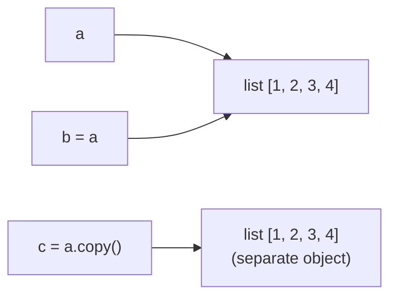

# Lists and List Methods in Python

## Introduction

A **list** (`list`) is an **ordered, mutable collection** of items. Items can be of any type, and the same value can appear many times. Lists are the most commonly used data structure in Python.

```python
nums = [1, 2, 3]
mixed = [1, "two", 3.0, True, None, [4, 5]]
empty = []
```

**Key properties:**

|**Property**|**Meaning**|
|---|---|
|**Ordered**|Items keep their insertion order and have indexes|
|**Mutable**|Items can be added, removed, and changed in place|
|**Heterogeneous**|Items can have different types|
|**Allows duplicates**|`[1, 1, 1]` is valid|
|**Dynamic size**|Grows and shrinks automatically|
|**Not hashable**|Cannot be a `dict` key or a `set` element (use `tuple` instead)|

**Lists vs. other collections:**

|**Feature**|**`list`**|**`tuple`**|**`set`**|**`dict`**|
|---|---|---|---|---|
|**Syntax**|`[1, 2]`|`(1, 2)`|`{1, 2}`|`{"a": 1}`|
|**Ordered**|Yes|Yes|No|Yes (3.7+)|
|**Mutable**|Yes|No|Yes|Yes|
|**Duplicates**|Yes|Yes|No|Unique keys|
|**Indexing**|Yes|Yes|No|By key|

---

## Creating Lists

```python
a = [1, 2, 3]                  # literal
b = []                         # empty list
c = list()                     # empty list via constructor
d = list("abc")                # ['a', 'b', 'c']
e = list(range(5))             # [0, 1, 2, 3, 4]
f = list((1, 2, 3))            # from a tuple
g = [0] * 5                    # [0, 0, 0, 0, 0]
h = [x ** 2 for x in range(5)] # list comprehension
i = "a,b,c".split(",")         # ['a', 'b', 'c']
```

### Pitfall: Repetition of Mutable Items

`*` copies **references**, not objects.

```python
matrix = [[0] * 3] * 3         # WRONG: three references to ONE inner list
matrix[0][0] = 1
print(matrix)                  # [[1, 0, 0], [1, 0, 0], [1, 0, 0]]

matrix = [[0] * 3 for _ in range(3)]   # RIGHT: independent inner lists
matrix[0][0] = 1
print(matrix)                  # [[1, 0, 0], [0, 0, 0], [0, 0, 0]]
```

---

## Indexing and Slicing

### Indexing

Indexes start at `0`; negative indexes count from the end.

```
 10   20   30   40   50
  0    1    2    3    4      <- positive indexes
 -5   -4   -3   -2   -1      <- negative indexes
```

```python
nums = [10, 20, 30, 40, 50]
nums[0]       # 10
nums[2]       # 30
nums[-1]      # 50
nums[-2]      # 40
nums[10]      # IndexError: list index out of range
```

Lists are **mutable**, so you can assign by index.

```python
nums[0] = 99          # [99, 20, 30, 40, 50]
```

### Slicing `lst[start:stop:step]`

- `start` — inclusive, default `0`.
- `stop` — **exclusive**, default `len(lst)`.
- `step` — default `1`; negative reverses direction.
- A slice always creates a **new list** (shallow copy) and never raises `IndexError`.

```python
nums = [10, 20, 30, 40, 50]
nums[1:3]       # [20, 30]
nums[:2]        # [10, 20]
nums[2:]        # [30, 40, 50]
nums[-2:]       # [40, 50]
nums[::2]       # [10, 30, 50]
nums[::-1]      # [50, 40, 30, 20, 10]  (reversed copy)
nums[:]         # shallow copy of the whole list
nums[1:100]     # [20, 30, 40, 50]
```

### Slice Assignment and Deletion

```python
nums = [1, 2, 3, 4, 5]
nums[1:3] = [20, 30]          # replace: [1, 20, 30, 4, 5]
nums[1:3] = [9]               # shrink:  [1, 9, 4, 5]
nums[1:1] = [7, 8]            # insert:  [1, 7, 8, 9, 4, 5]
nums[::2] = [0, 0, 0]         # extended slice: sizes must match
del nums[1:3]                 # delete a slice
nums[:] = []                  # clear in place
```

---

## Basic Operations

|**Operation**|**Example**|**Result**|
|---|---|---|
|Concatenation|`[1, 2] + [3]`|`[1, 2, 3]`|
|Repetition|`[0] * 3`|`[0, 0, 0]`|
|Length|`len([1, 2, 3])`|`3`|
|Membership|`2 in [1, 2, 3]`|`True`|
|Non-membership|`5 not in [1, 2, 3]`|`True`|
|Comparison|`[1, 2] < [1, 3]`|`True`|
|Equality|`[1, 2] == [1, 2]`|`True`|
|Iteration|`for x in lst: ...`|each item|

```python
[1, 2] + 3           # TypeError — both operands must be lists
[1, 2] + [3]         # [1, 2, 3]

[1, 2, 3] < [1, 2, 4]   # True  (lexicographic, element by element)
[1, 2] < [1, 2, 0]      # True  (shorter prefix is smaller)
```

**Built-in functions for lists:**

```python
nums = [4, 1, 7, 3]
len(nums)        # 4
sum(nums)        # 15
min(nums)        # 1
max(nums)        # 7
sorted(nums)     # [1, 3, 4, 7]  (new list)
any(nums)        # True  (at least one truthy)
all(nums)        # True  (all truthy)
list(reversed(nums))   # [3, 7, 1, 4]
```

---

## List Methods

> Most mutating methods **modify the list in place and return `None`**. Never write `lst = lst.sort()`.

### Overview

|**Method**|**Purpose**|**Returns**|**Mutates**|
|---|---|---|---|
|`append(x)`|Add an item to the end|`None`|Yes|
|`extend(iterable)`|Add all items of an iterable to the end|`None`|Yes|
|`insert(i, x)`|Insert an item before index `i`|`None`|Yes|
|`remove(x)`|Remove the first occurrence of `x`|`None`|Yes|
|`pop([i])`|Remove and return the item at `i` (default last)|the item|Yes|
|`clear()`|Remove all items|`None`|Yes|
|`index(x[, start, end])`|Index of the first occurrence|`int`|No|
|`count(x)`|Number of occurrences|`int`|No|
|`sort(key=None, reverse=False)`|Sort in place|`None`|Yes|
|`reverse()`|Reverse in place|`None`|Yes|
|`copy()`|Shallow copy|new `list`|No|

### 1. Adding Items

```python
lst = [1, 2, 3]

lst.append(4)              # [1, 2, 3, 4]
lst.append([5, 6])         # [1, 2, 3, 4, [5, 6]]  (added as ONE item)

lst = [1, 2, 3]
lst.extend([4, 5])         # [1, 2, 3, 4, 5]
lst.extend("ab")           # [1, 2, 3, 4, 5, 'a', 'b']
lst += [6]                 # same as extend

lst = [1, 2, 3]
lst.insert(0, 99)          # [99, 1, 2, 3]   (at the start)
lst.insert(2, 50)          # [99, 1, 50, 2, 3]
lst.insert(100, 7)         # appended at the end if index is too large
```

**`append` vs. `extend` vs. `+`:**

|**Expression**|**Result for `lst = [1, 2]`**|**Notes**|
|---|---|---|
|`lst.append([3, 4])`|`[1, 2, [3, 4]]`|Adds one item (a list)|
|`lst.extend([3, 4])`|`[1, 2, 3, 4]`|Adds each item, in place|
|`lst + [3, 4]`|`[1, 2, 3, 4]`|Creates a **new** list|

- `append` is **O(1)**; `insert` at the start is **O(n)** (all items shift).

### 2. Removing Items

```python
lst = [10, 20, 30, 20, 40]

lst.remove(20)             # [10, 30, 20, 40]  (only the FIRST 20)
lst.remove(99)             # ValueError: list.remove(x): x not in list

x = lst.pop()              # removes and returns the last item (40)
y = lst.pop(0)             # removes and returns item at index 0 (10)
lst.pop(10)                # IndexError

del lst[0]                 # delete by index (no return value)
del lst[1:3]               # delete a slice
lst.clear()                # []
```

|**Tool**|**Removes by**|**Returns**|**If missing**|
|---|---|---|---|
|`remove(x)`|Value (first match)|`None`|`ValueError`|
|`pop(i)`|Index|the item|`IndexError`|
|`del lst[i]`|Index or slice|nothing|`IndexError`|
|`clear()`|Everything|`None`|—|

- `pop()` from the end is **O(1)**; `pop(0)` and `remove` are **O(n)**.
- To remove **all** occurrences, build a new list: `lst = [x for x in lst if x != 20]`.
- For a queue (fast pops from the left) use `collections.deque`.

### 3. Searching and Counting

```python
lst = [10, 20, 30, 20, 40]

lst.index(20)          # 1        (first occurrence)
lst.index(20, 2)       # 3        (search starting at index 2)
lst.index(99)          # ValueError
lst.count(20)          # 2
lst.count(99)          # 0
20 in lst              # True     (preferred for a simple presence check)
```

- `index` raises `ValueError` if the item is missing; check with `in` first or use `try/except`.
- `in`, `index`, `count` are all **O(n)**.

### 4. Sorting

```python
nums = [3, 1, 4, 1, 5]

nums.sort()                    # [1, 1, 3, 4, 5]   in place
nums.sort(reverse=True)        # [5, 4, 3, 1, 1]

new = sorted(nums)             # new sorted list, original unchanged
```

**`sort()` vs. `sorted()`:**

|**Feature**|**`lst.sort()`**|**`sorted(iterable)`**|
|---|---|---|
|**Modifies**|The list in place|Nothing|
|**Returns**|`None`|A new list|
|**Works on**|Lists only|Any iterable|

**The `key` parameter** — a function applied to each item before comparison.

```python
words = ["banana", "Apple", "cherry"]

words.sort()                           # ['Apple', 'banana', 'cherry']  (uppercase first)
words.sort(key=str.lower)              # ['Apple', 'banana', 'cherry']  (case-insensitive)
words.sort(key=len)                    # sort by length

people = [("Ali", 25), ("Bek", 20), ("Cat", 30)]
people.sort(key=lambda p: p[1])        # by age
people.sort(key=lambda p: (-p[1], p[0]))   # by age desc, then name
```

```python
from operator import itemgetter
people.sort(key=itemgetter(1))
```

**Key points:**

- Sorting is **stable**: equal items keep their original relative order (allows multi-pass sorting).
- Items must be comparable: `[1, "a"].sort()` raises `TypeError`.
- Sorting is **O(n log n)** (Timsort).

### 5. Reversing

```python
lst = [1, 2, 3]
lst.reverse()              # [3, 2, 1]  in place, returns None

lst[::-1]                  # new reversed list
list(reversed(lst))        # new reversed list (reversed() returns an iterator)
```

### 6. Copying

```python
a = [1, 2, 3]
b = a                 # NOT a copy: both names refer to the SAME list
b.append(4)
print(a)              # [1, 2, 3, 4]

c = a.copy()          # shallow copy
d = a[:]              # shallow copy
e = list(a)           # shallow copy
```



**Shallow vs. deep copy:** a shallow copy duplicates the outer list only; inner mutable objects are still **shared**.

```python
a = [[1, 2], [3, 4]]
b = a.copy()
b[0].append(99)
print(a)              # [[1, 2, 99], [3, 4]]  — inner list changed in both!

import copy
c = copy.deepcopy(a)  # fully independent copy
```

---

## Iterating over Lists

```python
fruits = ["apple", "banana", "cherry"]

for fruit in fruits:                       # items
    print(fruit)

for i, fruit in enumerate(fruits):         # index + item
    print(i, fruit)

for i, fruit in enumerate(fruits, start=1):
    print(i, fruit)

for a, b in zip(fruits, [1, 2, 3]):        # parallel iteration
    print(a, b)

for fruit in reversed(fruits):             # backwards
    print(fruit)
```

- Do **not** add or remove items while iterating over the same list; iterate over a copy (`for x in lst[:]`) or build a new list.

---

## List Comprehensions

A compact way to build a list from an iterable.

```python
[expression for item in iterable if condition]
```

```python
squares = [x ** 2 for x in range(5)]                  # [0, 1, 4, 9, 16]
evens = [x for x in range(10) if x % 2 == 0]          # [0, 2, 4, 6, 8]
upper = [s.upper() for s in ["a", "b"]]               # ['A', 'B']
labels = ["even" if x % 2 == 0 else "odd" for x in range(4)]
flat = [x for row in [[1, 2], [3, 4]] for x in row]   # [1, 2, 3, 4]
pairs = [(x, y) for x in range(2) for y in range(2)]
matrix = [[0] * 3 for _ in range(3)]
```

- Filter `if` goes **at the end**; a conditional expression (`a if c else b`) goes **before** `for`.
- Prefer a regular loop when the logic is complex.
- Use a **generator expression** `(x for x in ...)` when you do not need the whole list in memory.

---

## Unpacking

```python
a, b, c = [1, 2, 3]            # a=1, b=2, c=3
first, *rest = [1, 2, 3, 4]    # first=1, rest=[2, 3, 4]
*init, last = [1, 2, 3, 4]     # init=[1, 2, 3], last=4
head, *mid, tail = [1, 2, 3, 4, 5]   # mid=[2, 3, 4]

a, b = b, a                    # swap without a temporary variable

[1, *[2, 3], 4]               # [1, 2, 3, 4]  (unpacking inside a literal)
```

- The number of names must match the number of items, except with one starred (`*`) name.

---

## Nested Lists

```python
matrix = [
    [1, 2, 3],
    [4, 5, 6],
    [7, 8, 9],
]

matrix[0]          # [1, 2, 3]
matrix[1][2]       # 6
matrix[-1][-1]     # 9

for row in matrix:
    for x in row:
        print(x, end=" ")
    print()

transposed = [list(row) for row in zip(*matrix)]
# [[1, 4, 7], [2, 5, 8], [3, 6, 9]]

flat = [x for row in matrix for x in row]
```

---

## Lists as Stack and Queue

**Stack (LIFO)** — use `append` and `pop` at the end (both O(1)).

```python
stack = []
stack.append(1)
stack.append(2)
stack.pop()        # 2
```

**Queue (FIFO)** — use `collections.deque`, not a list.

```python
from collections import deque

queue = deque([1, 2, 3])
queue.append(4)
queue.popleft()    # 1  (O(1); list.pop(0) would be O(n))
```

---

## Time Complexity

|**Operation**|**Complexity**|
|---|---|
|`lst[i]`, `lst[i] = x`|O(1)|
|`append(x)`|O(1) amortized|
|`pop()` (last)|O(1)|
|`pop(0)`, `insert(0, x)`|O(n)|
|`insert(i, x)`, `remove(x)`|O(n)|
|`x in lst`, `index`, `count`|O(n)|
|`lst[a:b]` (slice)|O(b - a)|
|`extend(k items)`|O(k)|
|`sort()`|O(n log n)|
|`copy()`, `reverse()`|O(n)|
|`len(lst)`|O(1)|

- For frequent membership checks use a `set`; for fast operations at both ends use `deque`.

---

## Useful Recipes

```python
# Remove duplicates, keep order
unique = list(dict.fromkeys([3, 1, 3, 2, 1]))        # [3, 1, 2]

# Remove duplicates, order not needed
unique = list(set([3, 1, 3, 2, 1]))

# Find the most common item
from collections import Counter
Counter([1, 2, 2, 3, 3, 3]).most_common(1)           # [(3, 3)]

# Split into chunks
chunks = [lst[i:i + 3] for i in range(0, len(lst), 3)]

# Join items into a string (items must be str)
", ".join(["a", "b", "c"])                            # 'a, b, c'
", ".join(map(str, [1, 2, 3]))                        # '1, 2, 3'

# Check if a list is empty
if not lst:
    print("empty")

# Index of the max item
nums.index(max(nums))

# Rotate left by k
lst[k:] + lst[:k]

# Flatten one level
from itertools import chain
list(chain.from_iterable([[1, 2], [3, 4]]))           # [1, 2, 3, 4]

# Filter and map
list(filter(lambda x: x > 0, nums))
list(map(str, nums))
```

---

## Common Pitfalls

|**Mistake**|**Problem / Fix**|
|---|---|
|`lst = lst.sort()`|`sort()` returns `None`; write `lst.sort()` or `lst = sorted(lst)`|
|`lst = lst.append(x)`|`append()` returns `None`; the list becomes `None`|
|`b = a` expecting a copy|Both names refer to one list; use `a.copy()` or `a[:]`|
|`[[0] * 3] * 3`|Rows are the same object; use `[[0] * 3 for _ in range(3)]`|
|`lst.append([4, 5])` expecting two items|Adds one nested list; use `extend`|
|Removing items while iterating|Items are skipped; iterate over a copy or use a comprehension|
|`lst.remove(x)` for a missing value|`ValueError`; check `x in lst` first|
|`lst.index(x)` for a missing value|`ValueError`; check with `in` or use `try/except`|
|`lst[10]` on a short list|`IndexError`; check `len(lst)` or use slicing|
|`pop()` on an empty list|`IndexError`; check `if lst:` first|
|Shallow copy with nested lists|Inner lists are shared; use `copy.deepcopy`|
|Mutable default argument `def f(x=[])`|The list is shared between calls; use `x=None` and create inside|
|`sort()` on mixed types|`TypeError`; use a `key` function|
|`lst + 5` or `lst + (1, 2)`|`TypeError`; both operands must be lists|
|`pop(0)` in a loop on a big list|O(n^2); use `collections.deque`|
|`lst += "ab"`|Extends with characters `'a'`, `'b'` (works like `extend`)|
|`for i in range(len(lst))` just to read items|Not Pythonic; use `for item in lst` or `enumerate`|

**Mutable default argument example:**

```python
def add(item, bucket=[]):         # BAD: one shared list for all calls
    bucket.append(item)
    return bucket

add(1)    # [1]
add(2)    # [1, 2]  <- surprise

def add(item, bucket=None):       # GOOD
    if bucket is None:
        bucket = []
    bucket.append(item)
    return bucket
```

---

## Summary

- A **list** is an **ordered, mutable** collection that allows duplicates and mixed types; create it with `[]`, `list()`, comprehensions, `split()`.
- **Indexing** `lst[i]` (negative from the end) and **slicing** `lst[start:stop:step]`; slices create new lists, can be assigned to and deleted; `lst[::-1]` reverses.
- **Operators:** `+` (concatenate), `*` (repeat), `in`, `len()`, comparison is lexicographic; `[[0] * n] * m` shares rows.
- **Adding:** `append` (one item), `extend` (many items), `insert` (at position). **Removing:** `remove` (by value), `pop` (by index, returns the item), `del`, `clear`.
- **Searching:** `index`, `count`, `in`. **Sorting:** `sort()` in place vs. `sorted()` new list, with `key` and `reverse`; stable, O(n log n).
- Mutating methods return **`None`**; never reassign their result.
- `b = a` creates an alias; use `copy()`, `[:]`, or `list()` for a shallow copy and `copy.deepcopy()` for nested structures.
- **List comprehensions** `[expr for x in it if cond]` are the Pythonic way to build and filter lists.
- **Unpacking** with `*` (`first, *rest = lst`), swapping with `a, b = b, a`.
- Know the costs: index and `append`/`pop()` are O(1); `insert`, `pop(0)`, `remove`, `in` are O(n); use `deque` for queues and `set` for fast membership.
- Do not modify a list while iterating over it, and avoid mutable default arguments.