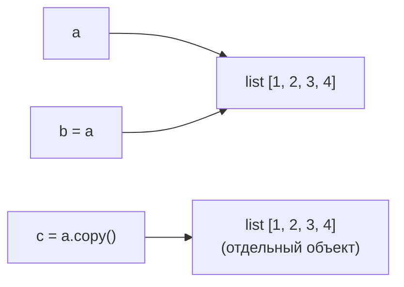

# Списки и методы списков в Python

## Введение

**Список** (`list`) — это **упорядоченная изменяемая коллекция** элементов. Элементы могут быть любого типа, а одно и то же значение может встречаться много раз. Списки — самая часто используемая структура данных в Python.

```python
nums = [1, 2, 3]
mixed = [1, "two", 3.0, True, None, [4, 5]]
empty = []
```

**Ключевые свойства:**

|**Свойство**|**Значение**|
|---|---|
|**Упорядоченность**|Элементы сохраняют порядок добавления и имеют индексы|
|**Изменяемость**|Элементы можно добавлять, удалять и менять на месте|
|**Разнородность**|Элементы могут иметь разные типы|
|**Допускает дубликаты**|`[1, 1, 1]` допустим|
|**Динамический размер**|Растёт и уменьшается автоматически|
|**Нехешируемость**|Не может быть ключом `dict` или элементом `set` (используйте `tuple`)|

**Списки и другие коллекции:**

|**Признак**|**`list`**|**`tuple`**|**`set`**|**`dict`**|
|---|---|---|---|---|
|**Синтаксис**|`[1, 2]`|`(1, 2)`|`{1, 2}`|`{"a": 1}`|
|**Упорядочен**|Да|Да|Нет|Да (3.7+)|
|**Изменяем**|Да|Нет|Да|Да|
|**Дубликаты**|Да|Да|Нет|Уникальные ключи|
|**Индексация**|Да|Да|Нет|По ключу|

---

## Создание списков

```python
a = [1, 2, 3]                  # литерал
b = []                         # пустой список
c = list()                     # пустой список через конструктор
d = list("abc")                # ['a', 'b', 'c']
e = list(range(5))             # [0, 1, 2, 3, 4]
f = list((1, 2, 3))            # из кортежа
g = [0] * 5                    # [0, 0, 0, 0, 0]
h = [x ** 2 for x in range(5)] # list comprehension
i = "a,b,c".split(",")         # ['a', 'b', 'c']
```

### Ловушка: повторение изменяемых элементов

`*` копирует **ссылки**, а не объекты.

```python
matrix = [[0] * 3] * 3         # НЕПРАВИЛЬНО: три ссылки на ОДИН внутренний список
matrix[0][0] = 1
print(matrix)                  # [[1, 0, 0], [1, 0, 0], [1, 0, 0]]

matrix = [[0] * 3 for _ in range(3)]   # ПРАВИЛЬНО: независимые внутренние списки
matrix[0][0] = 1
print(matrix)                  # [[1, 0, 0], [0, 0, 0], [0, 0, 0]]
```

---

## Индексация и срезы

### Индексация

Индексы начинаются с `0`; отрицательные индексы считаются с конца.

```
 10   20   30   40   50
  0    1    2    3    4      <- положительные индексы
 -5   -4   -3   -2   -1      <- отрицательные индексы
```

```python
nums = [10, 20, 30, 40, 50]
nums[0]       # 10
nums[2]       # 30
nums[-1]      # 50
nums[-2]      # 40
nums[10]      # IndexError: list index out of range
```

Списки **изменяемы**, поэтому можно присваивать по индексу.

```python
nums[0] = 99          # [99, 20, 30, 40, 50]
```

### Срезы `lst[start:stop:step]`

- `start` — включительно, по умолчанию `0`.
- `stop` — **не включается**, по умолчанию `len(lst)`.
- `step` — по умолчанию `1`; отрицательный меняет направление.
- Срез всегда создаёт **новый список** (поверхностную копию) и никогда не вызывает `IndexError`.

```python
nums = [10, 20, 30, 40, 50]
nums[1:3]       # [20, 30]
nums[:2]        # [10, 20]
nums[2:]        # [30, 40, 50]
nums[-2:]       # [40, 50]
nums[::2]       # [10, 30, 50]
nums[::-1]      # [50, 40, 30, 20, 10]  (развёрнутая копия)
nums[:]         # поверхностная копия всего списка
nums[1:100]     # [20, 30, 40, 50]
```

### Присваивание и удаление срезов

```python
nums = [1, 2, 3, 4, 5]
nums[1:3] = [20, 30]          # замена:    [1, 20, 30, 4, 5]
nums[1:3] = [9]               # сжатие:    [1, 9, 4, 5]
nums[1:1] = [7, 8]            # вставка:   [1, 7, 8, 9, 4, 5]
nums[::2] = [0, 0, 0]         # расширенный срез: размеры должны совпадать
del nums[1:3]                 # удалить срез
nums[:] = []                  # очистить на месте
```

---

## Базовые операции

|**Операция**|**Пример**|**Результат**|
|---|---|---|
|Конкатенация|`[1, 2] + [3]`|`[1, 2, 3]`|
|Повторение|`[0] * 3`|`[0, 0, 0]`|
|Длина|`len([1, 2, 3])`|`3`|
|Принадлежность|`2 in [1, 2, 3]`|`True`|
|Отсутствие|`5 not in [1, 2, 3]`|`True`|
|Сравнение|`[1, 2] < [1, 3]`|`True`|
|Равенство|`[1, 2] == [1, 2]`|`True`|
|Итерация|`for x in lst: ...`|каждый элемент|

```python
[1, 2] + 3           # TypeError — оба операнда должны быть списками
[1, 2] + [3]         # [1, 2, 3]

[1, 2, 3] < [1, 2, 4]   # True  (лексикографически, поэлементно)
[1, 2] < [1, 2, 0]      # True  (более короткий префикс меньше)
```

**Встроенные функции для списков:**

```python
nums = [4, 1, 7, 3]
len(nums)        # 4
sum(nums)        # 15
min(nums)        # 1
max(nums)        # 7
sorted(nums)     # [1, 3, 4, 7]  (новый список)
any(nums)        # True  (хотя бы один истинный)
all(nums)        # True  (все истинные)
list(reversed(nums))   # [3, 7, 1, 4]
```

---

## Методы списков

> Большинство изменяющих методов **модифицируют список на месте и возвращают `None`**. Никогда не пишите `lst = lst.sort()`.

### Обзор

|**Метод**|**Назначение**|**Возвращает**|**Изменяет**|
|---|---|---|---|
|`append(x)`|Добавить элемент в конец|`None`|Да|
|`extend(iterable)`|Добавить все элементы итерируемого объекта в конец|`None`|Да|
|`insert(i, x)`|Вставить элемент перед индексом `i`|`None`|Да|
|`remove(x)`|Удалить первое вхождение `x`|`None`|Да|
|`pop([i])`|Удалить и вернуть элемент по `i` (по умолчанию последний)|элемент|Да|
|`clear()`|Удалить все элементы|`None`|Да|
|`index(x[, start, end])`|Индекс первого вхождения|`int`|Нет|
|`count(x)`|Число вхождений|`int`|Нет|
|`sort(key=None, reverse=False)`|Сортировка на месте|`None`|Да|
|`reverse()`|Разворот на месте|`None`|Да|
|`copy()`|Поверхностная копия|новый `list`|Нет|

### 1. Добавление элементов

```python
lst = [1, 2, 3]

lst.append(4)              # [1, 2, 3, 4]
lst.append([5, 6])         # [1, 2, 3, 4, [5, 6]]  (добавлен как ОДИН элемент)

lst = [1, 2, 3]
lst.extend([4, 5])         # [1, 2, 3, 4, 5]
lst.extend("ab")           # [1, 2, 3, 4, 5, 'a', 'b']
lst += [6]                 # то же, что extend

lst = [1, 2, 3]
lst.insert(0, 99)          # [99, 1, 2, 3]   (в начало)
lst.insert(2, 50)          # [99, 1, 50, 2, 3]
lst.insert(100, 7)         # добавляется в конец, если индекс слишком большой
```

**`append`, `extend` и `+`:**

|**Выражение**|**Результат для `lst = [1, 2]`**|**Примечания**|
|---|---|---|
|`lst.append([3, 4])`|`[1, 2, [3, 4]]`|Добавляет один элемент (список)|
|`lst.extend([3, 4])`|`[1, 2, 3, 4]`|Добавляет каждый элемент, на месте|
|`lst + [3, 4]`|`[1, 2, 3, 4]`|Создаёт **новый** список|

- `append` — **O(1)**; `insert` в начало — **O(n)** (все элементы сдвигаются).

### 2. Удаление элементов

```python
lst = [10, 20, 30, 20, 40]

lst.remove(20)             # [10, 30, 20, 40]  (только ПЕРВОЕ 20)
lst.remove(99)             # ValueError: list.remove(x): x not in list

x = lst.pop()              # удаляет и возвращает последний элемент (40)
y = lst.pop(0)             # удаляет и возвращает элемент с индексом 0 (10)
lst.pop(10)                # IndexError

del lst[0]                 # удалить по индексу (без возвращаемого значения)
del lst[1:3]               # удалить срез
lst.clear()                # []
```

|**Инструмент**|**Удаляет по**|**Возвращает**|**Если нет элемента**|
|---|---|---|---|
|`remove(x)`|Значению (первое совпадение)|`None`|`ValueError`|
|`pop(i)`|Индексу|элемент|`IndexError`|
|`del lst[i]`|Индексу или срезу|ничего|`IndexError`|
|`clear()`|Всё|`None`|—|

- `pop()` с конца — **O(1)**; `pop(0)` и `remove` — **O(n)**.
- Чтобы удалить **все** вхождения, постройте новый список: `lst = [x for x in lst if x != 20]`.
- Для очереди (быстрое удаление слева) используйте `collections.deque`.

### 3. Поиск и подсчёт

```python
lst = [10, 20, 30, 20, 40]

lst.index(20)          # 1        (первое вхождение)
lst.index(20, 2)       # 3        (поиск начиная с индекса 2)
lst.index(99)          # ValueError
lst.count(20)          # 2
lst.count(99)          # 0
20 in lst              # True     (предпочтительно для простой проверки наличия)
```

- `index` вызывает `ValueError`, если элемента нет; сначала проверьте через `in` или используйте `try/except`.
- `in`, `index`, `count` — все **O(n)**.

### 4. Сортировка

```python
nums = [3, 1, 4, 1, 5]

nums.sort()                    # [1, 1, 3, 4, 5]   на месте
nums.sort(reverse=True)        # [5, 4, 3, 1, 1]

new = sorted(nums)             # новый отсортированный список, оригинал не меняется
```

**`sort()` и `sorted()`:**

|**Признак**|**`lst.sort()`**|**`sorted(iterable)`**|
|---|---|---|
|**Изменяет**|Список на месте|Ничего|
|**Возвращает**|`None`|Новый список|
|**Работает с**|Только со списками|С любым итерируемым объектом|

**Параметр `key`** — функция, применяемая к каждому элементу перед сравнением.

```python
words = ["banana", "Apple", "cherry"]

words.sort()                           # ['Apple', 'banana', 'cherry']  (заглавные первыми)
words.sort(key=str.lower)              # ['Apple', 'banana', 'cherry']  (без учёта регистра)
words.sort(key=len)                    # сортировка по длине

people = [("Ali", 25), ("Bek", 20), ("Cat", 30)]
people.sort(key=lambda p: p[1])        # по возрасту
people.sort(key=lambda p: (-p[1], p[0]))   # по возрасту по убыванию, затем по имени
```

```python
from operator import itemgetter
people.sort(key=itemgetter(1))
```

**Ключевые моменты:**

- Сортировка **устойчивая (stable)**: равные элементы сохраняют исходный относительный порядок (позволяет сортировать в несколько проходов).
- Элементы должны быть сравнимы: `[1, "a"].sort()` вызывает `TypeError`.
- Сортировка — **O(n log n)** (Timsort).

### 5. Разворот

```python
lst = [1, 2, 3]
lst.reverse()              # [3, 2, 1]  на месте, возвращает None

lst[::-1]                  # новый развёрнутый список
list(reversed(lst))        # новый развёрнутый список (reversed() возвращает итератор)
```

### 6. Копирование

```python
a = [1, 2, 3]
b = a                 # НЕ копия: оба имени ссылаются на ОДИН список
b.append(4)
print(a)              # [1, 2, 3, 4]

c = a.copy()          # поверхностная копия
d = a[:]              # поверхностная копия
e = list(a)           # поверхностная копия
```



**Поверхностная и глубокая копия:** поверхностная копия дублирует только внешний список; внутренние изменяемые объекты по-прежнему **общие**.

```python
a = [[1, 2], [3, 4]]
b = a.copy()
b[0].append(99)
print(a)              # [[1, 2, 99], [3, 4]]  — внутренний список изменился в обоих!

import copy
c = copy.deepcopy(a)  # полностью независимая копия
```

---

## Итерация по спискам

```python
fruits = ["apple", "banana", "cherry"]

for fruit in fruits:                       # элементы
    print(fruit)

for i, fruit in enumerate(fruits):         # индекс + элемент
    print(i, fruit)

for i, fruit in enumerate(fruits, start=1):
    print(i, fruit)

for a, b in zip(fruits, [1, 2, 3]):        # параллельная итерация
    print(a, b)

for fruit in reversed(fruits):             # в обратном порядке
    print(fruit)
```

- **Не** добавляйте и не удаляйте элементы во время итерации по тому же списку; итерируйте по копии (`for x in lst[:]`) или стройте новый список.

---

## List Comprehensions

Компактный способ построить список из итерируемого объекта.

```python
[expression for item in iterable if condition]
```

```python
squares = [x ** 2 for x in range(5)]                  # [0, 1, 4, 9, 16]
evens = [x for x in range(10) if x % 2 == 0]          # [0, 2, 4, 6, 8]
upper = [s.upper() for s in ["a", "b"]]               # ['A', 'B']
labels = ["even" if x % 2 == 0 else "odd" for x in range(4)]
flat = [x for row in [[1, 2], [3, 4]] for x in row]   # [1, 2, 3, 4]
pairs = [(x, y) for x in range(2) for y in range(2)]
matrix = [[0] * 3 for _ in range(3)]
```

- Фильтр `if` ставится **в конце**; условное выражение (`a if c else b`) — **перед** `for`.
- Если логика сложная, лучше обычный цикл.
- Используйте **генераторное выражение** `(x for x in ...)`, когда весь список в памяти не нужен.

---

## Распаковка

```python
a, b, c = [1, 2, 3]            # a=1, b=2, c=3
first, *rest = [1, 2, 3, 4]    # first=1, rest=[2, 3, 4]
*init, last = [1, 2, 3, 4]     # init=[1, 2, 3], last=4
head, *mid, tail = [1, 2, 3, 4, 5]   # mid=[2, 3, 4]

a, b = b, a                    # обмен без временной переменной

[1, *[2, 3], 4]               # [1, 2, 3, 4]  (распаковка внутри литерала)
```

- Число имён должно совпадать с числом элементов, кроме случая с одним именем со звёздочкой (`*`).

---

## Вложенные списки

```python
matrix = [
    [1, 2, 3],
    [4, 5, 6],
    [7, 8, 9],
]

matrix[0]          # [1, 2, 3]
matrix[1][2]       # 6
matrix[-1][-1]     # 9

for row in matrix:
    for x in row:
        print(x, end=" ")
    print()

transposed = [list(row) for row in zip(*matrix)]
# [[1, 4, 7], [2, 5, 8], [3, 6, 9]]

flat = [x for row in matrix for x in row]
```

---

## Списки как стек и очередь

**Стек (LIFO)** — используйте `append` и `pop` в конце (оба O(1)).

```python
stack = []
stack.append(1)
stack.append(2)
stack.pop()        # 2
```

**Очередь (FIFO)** — используйте `collections.deque`, а не список.

```python
from collections import deque

queue = deque([1, 2, 3])
queue.append(4)
queue.popleft()    # 1  (O(1); list.pop(0) был бы O(n))
```

---

## Временная сложность

|**Операция**|**Сложность**|
|---|---|
|`lst[i]`, `lst[i] = x`|O(1)|
|`append(x)`|O(1) амортизированно|
|`pop()` (последний)|O(1)|
|`pop(0)`, `insert(0, x)`|O(n)|
|`insert(i, x)`, `remove(x)`|O(n)|
|`x in lst`, `index`, `count`|O(n)|
|`lst[a:b]` (срез)|O(b - a)|
|`extend(k элементов)`|O(k)|
|`sort()`|O(n log n)|
|`copy()`, `reverse()`|O(n)|
|`len(lst)`|O(1)|

- Для частых проверок принадлежности используйте `set`; для быстрых операций с обоих концов — `deque`.

---

## Полезные рецепты

```python
# Убрать дубликаты, сохранив порядок
unique = list(dict.fromkeys([3, 1, 3, 2, 1]))        # [3, 1, 2]

# Убрать дубликаты, порядок не важен
unique = list(set([3, 1, 3, 2, 1]))

# Найти самый частый элемент
from collections import Counter
Counter([1, 2, 2, 3, 3, 3]).most_common(1)           # [(3, 3)]

# Разбить на части
chunks = [lst[i:i + 3] for i in range(0, len(lst), 3)]

# Объединить элементы в строку (элементы должны быть str)
", ".join(["a", "b", "c"])                            # 'a, b, c'
", ".join(map(str, [1, 2, 3]))                        # '1, 2, 3'

# Проверить, пуст ли список
if not lst:
    print("empty")

# Индекс максимального элемента
nums.index(max(nums))

# Циклический сдвиг влево на k
lst[k:] + lst[:k]

# Разгладить на один уровень
from itertools import chain
list(chain.from_iterable([[1, 2], [3, 4]]))           # [1, 2, 3, 4]

# Фильтрация и отображение
list(filter(lambda x: x > 0, nums))
list(map(str, nums))
```

---

## Типичные ошибки

|**Ошибка**|**Проблема / Исправление**|
|---|---|
|`lst = lst.sort()`|`sort()` возвращает `None`; пишите `lst.sort()` или `lst = sorted(lst)`|
|`lst = lst.append(x)`|`append()` возвращает `None`; список превращается в `None`|
|`b = a` в ожидании копии|Оба имени ссылаются на один список; используйте `a.copy()` или `a[:]`|
|`[[0] * 3] * 3`|Строки — один и тот же объект; используйте `[[0] * 3 for _ in range(3)]`|
|`lst.append([4, 5])` в ожидании двух элементов|Добавляется один вложенный список; используйте `extend`|
|Удаление элементов во время итерации|Элементы пропускаются; итерируйте по копии или используйте comprehension|
|`lst.remove(x)` для отсутствующего значения|`ValueError`; сначала проверьте `x in lst`|
|`lst.index(x)` для отсутствующего значения|`ValueError`; проверьте через `in` или используйте `try/except`|
|`lst[10]` на коротком списке|`IndexError`; проверьте `len(lst)` или используйте срез|
|`pop()` на пустом списке|`IndexError`; сначала проверьте `if lst:`|
|Поверхностная копия с вложенными списками|Внутренние списки общие; используйте `copy.deepcopy`|
|Изменяемый аргумент по умолчанию `def f(x=[])`|Список общий для всех вызовов; используйте `x=None` и создавайте внутри|
|`sort()` по смешанным типам|`TypeError`; используйте функцию `key`|
|`lst + 5` или `lst + (1, 2)`|`TypeError`; оба операнда должны быть списками|
|`pop(0)` в цикле на большом списке|O(n^2); используйте `collections.deque`|
|`lst += "ab"`|Расширяет символами `'a'`, `'b'` (работает как `extend`)|
|`for i in range(len(lst))` только чтобы читать элементы|Не Pythonic; используйте `for item in lst` или `enumerate`|

**Пример с изменяемым аргументом по умолчанию:**

```python
def add(item, bucket=[]):         # ПЛОХО: один общий список для всех вызовов
    bucket.append(item)
    return bucket

add(1)    # [1]
add(2)    # [1, 2]  <- сюрприз

def add(item, bucket=None):       # ХОРОШО
    if bucket is None:
        bucket = []
    bucket.append(item)
    return bucket
```

---

## Итоги

- **Список** — это **упорядоченная изменяемая** коллекция, допускающая дубликаты и разные типы; создаётся через `[]`, `list()`, comprehensions, `split()`.
- **Индексация** `lst[i]` (отрицательные — с конца) и **срезы** `lst[start:stop:step]`; срезы создают новые списки, им можно присваивать и их можно удалять; `lst[::-1]` разворачивает.
- **Операторы:** `+` (конкатенация), `*` (повторение), `in`, `len()`, сравнение лексикографическое; `[[0] * n] * m` делит строки между собой.
- **Добавление:** `append` (один элемент), `extend` (много элементов), `insert` (в позицию). **Удаление:** `remove` (по значению), `pop` (по индексу, возвращает элемент), `del`, `clear`.
- **Поиск:** `index`, `count`, `in`. **Сортировка:** `sort()` на месте и `sorted()` — новый список, с `key` и `reverse`; устойчивая, O(n log n).
- Изменяющие методы возвращают **`None`**; никогда не присваивайте их результат.
- `b = a` создаёт псевдоним; для поверхностной копии используйте `copy()`, `[:]` или `list()`, а для вложенных структур — `copy.deepcopy()`.
- **List comprehensions** `[expr for x in it if cond]` — Pythonic-способ строить и фильтровать списки.
- **Распаковка** через `*` (`first, *rest = lst`), обмен через `a, b = b, a`.
- Знайте стоимость операций: индекс, `append`/`pop()` — O(1); `insert`, `pop(0)`, `remove`, `in` — O(n); для очередей используйте `deque`, для быстрой проверки принадлежности — `set`.
- Не изменяйте список во время итерации по нему и избегайте изменяемых аргументов по умолчанию.